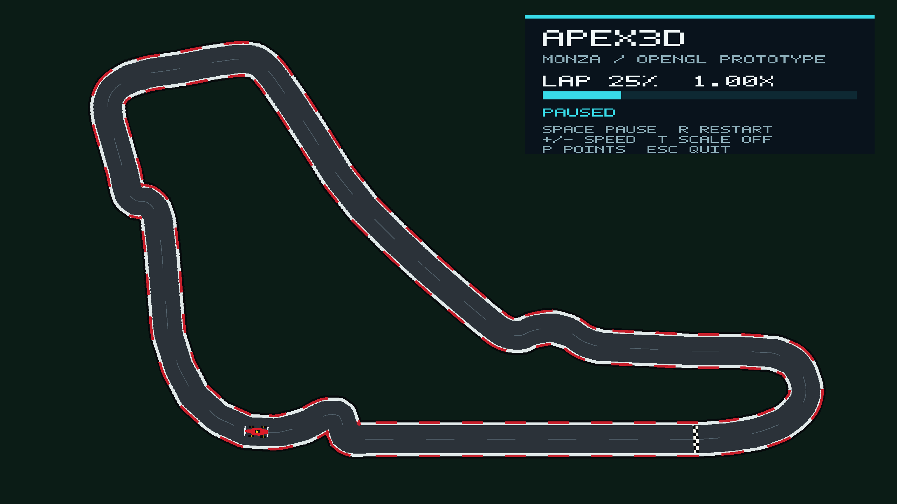

# Apex3D

Apex3D is an ICS 3204 Computer Graphics semester project that turns Formula 1
circuit geometry into a progressively richer visualisation. Checkpoints 1 and 2
demonstrate the underlying graphics algorithms in C++20. The Checkpoint 3
prototype brings the track and an animated Formula 1 car together in OpenGL.

## Current milestone: Checkpoint 3 prototype

The runnable OpenGL application now displays a filled Monza circuit and a
polygon Formula 1 car moving around it. It reuses the CP2 Catmull-Rom curve,
transformation matrix and polygon-car model. The path is resampled by distance
so the car travels at approximately uniform speed and faces the tangent of the
circuit. A small in-window display shows lap progress and controls.



### Build and run

Requires CMake 3.24 or later, a C++20 compiler and an OpenGL 3.3 capable
desktop. CMake fetches GLFW; GLAD is included in the repository.

```bash
cmake -S . -B build
cmake --build build --parallel
ctest --test-dir build --output-on-failure
./build/Apex3D
```

On Windows, the executable may be under `build/Debug/Apex3D.exe`.

| Key | Action |
| --- | --- |
| `Space` | Play or pause the lap |
| `R` | Restart from the start/finish line |
| `+` / `-` | Increase or decrease playback speed |
| `T` | Toggle the scaling demonstration |
| `P` | Show or hide Monza control points |
| `Esc` | Quit |

To capture a real OpenGL frame as a PPM image:

```bash
./build/Apex3D --screenshot frame.ppm
./build/Apex3D --screenshot-at 0.25 quarter_lap.ppm
```

The second command renders the car at 25% lap progress. The accepted progress
range is 0 to 1.

## Checkpoint 2 foundation

Checkpoint 2 builds on the graphical components from Checkpoint 1 by applying
2D transformations and frame-based animation to a simplified Formula 1 car.
The repository now contains six independently runnable CP2 milestones:

- 3 × 3 homogeneous transformations: translation, rotation, scaling, pivot
  rotation, composition and polygon transformation
- animation timeline, linear position interpolation and shortest-arc heading
  interpolation
- hierarchical wheel rotation and rolling-without-slipping motion
- keyframed polygon-car translation, rotation, scaling and combined motion
- tangent-oriented Catmull–Rom circuit animation
- tangent-oriented cubic Bézier animation with approximate arc-length sampling

All CP2 work is implemented in C++20 without OpenGL or another graphics
library. The programs rasterise their own PPM evidence images on the CPU.

## Group members and responsibilities

| Member | Responsibilities demonstrated in the repository |
| --- | --- |
| Omar Siddique | Project coordination, transformation engine, CP2 Bézier animation, CP3 OpenGL integration, verification and evidence |
| Hetvi Barot | Polygon representation and filling; keyframed polygon Formula 1 car animation |
| Azhar Ahmed | Line algorithms; CP2 timeline verification, cleanup and documentation |
| Nyariki | Midpoint circles and ellipses; hierarchical wheel animation |
| Casper Muhereza | Checkpoint 1 Bézier foundations and the initial CP2 timeline/interpolation implementation |
| Shadrack Mungai | Closed Catmull–Rom spline path and tangent-oriented lap animation |

## Technologies and tools

- C++20 standard library
- Handwritten CPU rasterisation and graphics algorithms
- 3 × 3 homogeneous transformation matrices
- PPM and PNG evidence outputs
- CMake, GLFW, GLAD and OpenGL 3.3 for the integrated prototype
- Git and GitHub pull-request workflow

## Verify Checkpoint 2

On macOS or Linux, run the complete strict verification from the repository
root:

```bash
checkpoint2/verify_all.sh
```

The script compiles every CP2 test and demonstration with:

```text
-std=c++20 -Wall -Wextra -Wpedantic
```

It runs the transformation, timeline, wheel, polygon-car, spline and Bézier
test suites and regenerates disposable evidence in a temporary directory.

Each milestone also has its own README with individual build and run commands:

- [Checkpoint 2 overview](checkpoint2/README.md)
- [Transformations](checkpoint2/transformations/README.md)
- [Timeline and interpolation](checkpoint2/animation/timeline/README.md)
- [Wheel animation](checkpoint2/animation/wheels/README.md)
- [Polygon-car animation](checkpoint2/animation/car/README.md)
- [Catmull–Rom motion](checkpoint2/animation/splines/README.md)
- [Bézier motion](checkpoint2/animation/bezier/README.md)

## Evidence and documentation

- [CP3 progress and remaining work](docs/checkpoint3-progress.md)
- [CP3 OpenGL screenshot](docs/evidence/cp3-opengl-prototype.png)
- [CP2 readiness checklist](docs/checkpoint2-readiness.md)
- [CP2 evidence PDF](output/pdf/Apex3D_Checkpoint2_Evidence.pdf)
- [Architecture and rendering pipeline](docs/architecture.md)
- [Contribution workflow](CONTRIBUTING.md)
- [Algorithm notes](docs/algorithms/)

## Current limitations

- The CP3 prototype is a top-down 2D OpenGL scene. Perspective, elevation and
  a full 3D car remain final-project work.
- The path and car are simplified, hand-authored geometry rather than actual
  telemetry-derived data.
- Raster edges are not anti-aliased.
- Catmull-Rom travel distance is estimated from a sampled path. It is
  approximately, not exactly, constant-speed.
- The CP2 wheel hierarchy and Bézier lap are still separate demonstrations.
  They are not selectable in the OpenGL prototype yet.
- Camera control, perspective, lighting and telemetry heatmaps remain
  final-project work.

## Reference

The circuit work uses the official Formula 1 Monza map as a shape reference:
[Italy — Autodromo Nazionale Monza](https://www.formula1.com/en/information/italy-autodromo-nazionale-monza.FiJN1jnQlRLeHqOxIt13m).
