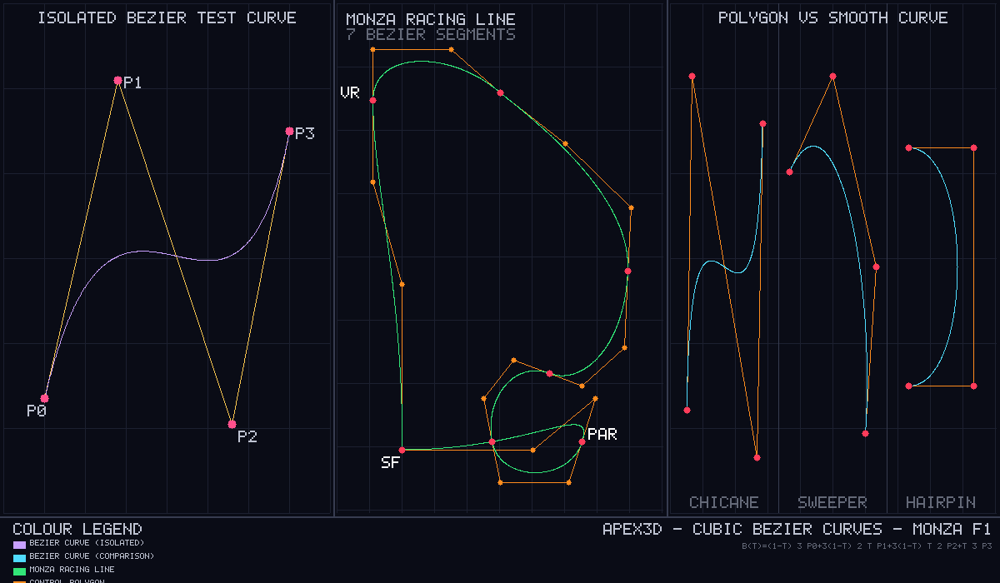

# Checkpoint 1 — Cubic Bézier Curves

A self-contained C++20 program that demonstrates cubic Bézier curve mathematics
applied to Formula 1 circuit geometry. It renders three panels into an in-memory
RGB canvas and saves the result as `output/bezier_demo.ppm` (also provided as
`output/bezier_demo.png`). No graphics library is used: every pixel is written
through `Canvas::setPixel`.



---

## Build and run

From the **repository root**:

```bash
c++ -std=c++20 -Wall -Wextra -Wpedantic checkpoint1/bezier/main.cpp -o /tmp/apex3d-bezier
/tmp/apex3d-bezier
```

Expected terminal output (pixel count may vary slightly by platform/compiler):

```
Apex3D Bezier self-checks:
  [self-check] B(0) == P0  : PASS
  [self-check] B(1) == P3  : PASS
  [self-check] degenerate  : PASS
  [self-check] collinear   : PASS
  All self-checks passed.

Apex3D Checkpoint 1 - Cubic Bezier Curves
  Canvas             : 1200 x 700 RGB
  Curves drawn       : 11
  Samples per curve  : 500  (t steps 0 to 1)
  Total Bezier pixels: 6623
  Output             : checkpoint1/bezier/output/bezier_demo.ppm
```

The PPM opens in GIMP, IrfanView, macOS Preview, most Linux image viewers, and
VS Code with an image-preview extension. To convert with ImageMagick:

```bash
convert bezier_demo.ppm bezier_demo.png
```

---

## The Bernstein polynomial equation

A cubic Bézier curve is defined by **four control points** P0, P1, P2, P3 and a
scalar parameter *t* in [0, 1]:

```
B(t) = (1-t)^3 * P0  +  3(1-t)^2 * t * P1  +  3(1-t) * t^2 * P2  +  t^3 * P3
```

The four coefficients are the **Bernstein basis polynomials** of degree 3:

| Basis polynomial | Formula        | Value at t=0 | Value at t=1 |
|-----------------|----------------|-------------|-------------|
| b0(t)           | (1-t)^3        | 1           | 0           |
| b1(t)           | 3(1-t)^2 * t   | 0           | 0           |
| b2(t)           | 3(1-t) * t^2   | 0           | 0           |
| b3(t)           | t^3            | 0           | 1           |

They always sum to 1, so B(t) is a **convex combination** of the four control
points — the curve lies inside the convex hull of P0…P3.

---

## What the four control points do

| Point | Role |
|-------|------|
| **P0** | The curve **starts** here exactly (`B(0) = P0`). |
| **P1** | Tangent handle: the curve **leaves P0 in the direction P0 → P1**. P1 is not on the curve. |
| **P2** | Tangent handle: the curve **arrives at P3 from the direction P2 → P3**. P2 is not on the curve. |
| **P3** | The curve **ends** here exactly (`B(1) = P3`). |

Moving P1 closer to P0 tightens the curve near the start; moving it farther
strengthens the initial tangent. P2 works the same way at the end.

---

## The role of parameter *t*

*t* is a normalised value that travels from 0 (the start) to 1 (the end).
At t = 0 the formula evaluates to P0; at t = 1 it evaluates to P3.
At t = 0.5 the curve is roughly halfway between the endpoints.
A single cubic Bézier polynomial is infinitely differentiable inside its own
interval [0, 1] — it has no kinks within one segment. When multiple segments
are chained together, smoothness at the joins depends on the continuity
conditions between adjacent segments, not on the polynomial degree alone
(see *How Bézier curves smooth the Monza circuit* below).

---

## How sampling turns the mathematical curve into pixels

The Bézier formula gives a **continuous curve**, not discrete pixels.
To draw it on screen the program:

1. Divides [0, 1] into **500 equal steps** (`kBezierSteps`).
2. Evaluates `B(t)` at each step to get a 2-D floating-point point.
3. **Rounds** each point to the nearest integer pixel coordinate.
4. Joins consecutive sample points with a **Bresenham line segment** so there
   are no visible gaps even when the curve moves more than one pixel between
   adjacent samples.

500 steps is sufficient for a curve spanning ~400 pixels; individual steps are
sub-pixel so every pixel on the curve is filled.

---

## How Bézier curves smooth the Monza circuit

Connecting Monza waypoints with straight lines produces a polygon with sharp
corners — what a car cannot drive at 350 km/h. Bézier smoothing replaces each
corner with a cubic segment:

* **P0** and **P3** are placed at the waypoints (join nodes).
* **P1** and **P2** are placed along the *incoming* and *outgoing tangent*
  directions respectively.
* Adjacent segments share their endpoint (**C0 positional continuity** is
  guaranteed). The handles are manually arranged so that P2_i, P3_i and
  P1_{i+1} are collinear in the same direction, which gives **G1 geometric
  continuity** — a visually smooth tangent with no kink — at most joins.
* **C1 parametric continuity** is *not* enforced. Exact C1 for
  equally-parameterised cubic segments requires:

  ```
  P3_i - P2_i  =  P1_{i+1} - P0_{i+1}
  ```

  (equal tangent *vectors*, not just collinearity). There is no automatic
  tangent solver here.
* The closed **start/finish join** (last segment back to first) is not
  guaranteed to be tangent-continuous.

The centre panel shows seven chained segments approximating a full Monza lap,
with the orange control polygon visible behind the smooth green racing line.

---

## Image layout and colour legend

The 1200×700 canvas is divided into three equal panels:

| Panel | Content |
|-------|---------|
| Left  | **Isolated test curve** — one S-shaped cubic Bézier with labelled P0…P3 |
| Centre | **Monza racing line** — seven chained segments forming a closed lap |
| Right | **Comparison** — chicane, sweeper, hairpin showing polygon vs smooth curve |

| Colour | Meaning |
|--------|---------|
| Violet `(200,160,255)` | Bézier curve — isolated test panel |
| Cyan `(80,220,255)` | Bézier curves — comparison panel |
| Green `(50,230,120)` | Monza racing line (chained segments) |
| Orange `(255,140,30)` | Control polygons (straight-line skeleton) |
| Red `(255,60,90)` | Control-point circle markers |
| White `(255,255,255)` | Landmark labels (SF, VR, PAR) |

---

## Known limitations

* Lines are **1 pixel wide** and aliased; no anti-aliasing or stroke width.
* Sampling uses **uniform spacing in t**, not arc-length parameterisation.
  Dense curvature regions may receive fewer samples, though 500 steps
  mitigates this for this canvas size.
* **C1 continuity** is *not* automatically enforced. Handles are manually
  aligned to give G1 geometric continuity (collinearity in the same direction)
  at most joins; there is no automatic tangent solver (Catmull–Rom, etc.).
  The closed start/finish join is not guaranteed to be tangent-continuous.
* Monza coordinates are **hand-authored** approximations, not real GPS data.
* The bitmap font supports only **uppercase ASCII** (A–Z, 0–9, punctuation).
* The PPM is not natively viewable in most browsers. The committed PNG was
  generated with a pure-Python stdlib converter (`zlib` + `struct`).
