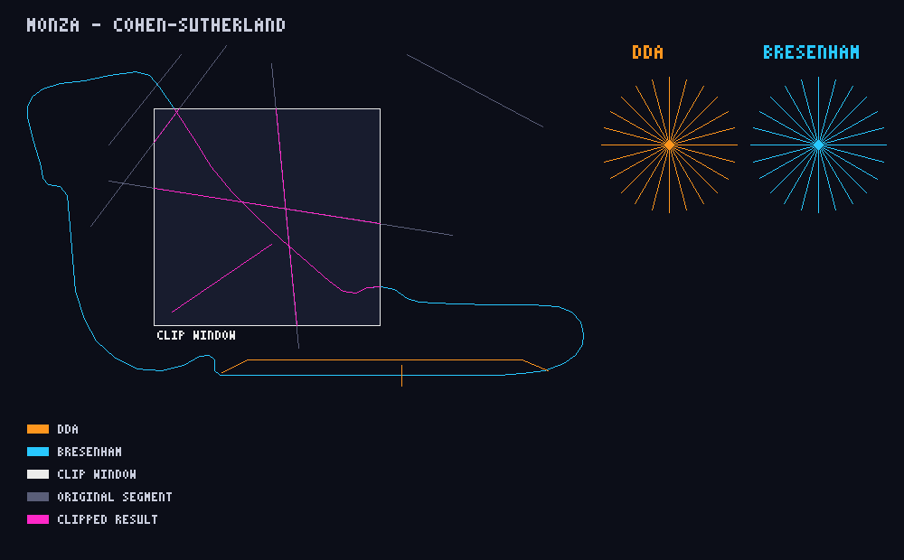

# Checkpoint 1 — Pure C++ line algorithms

A self-contained C++20 program that draws Apex3D's Monza circuit and a set of test segments into an in-memory RGB canvas, using only hand-written algorithms. It does not use OpenGL, GLFW or any other drawing library. Every pixel goes through `Canvas::setPixel`, and the finished canvas is saved as `output/lines_demo.ppm`.



## Build and run

From the repository root:

```bash
c++ -std=c++20 -Wall -Wextra -Wpedantic checkpoint1/lines/main.cpp -o /tmp/apex3d-lines
/tmp/apex3d-lines
```

The image is written to `checkpoint1/lines/output/lines_demo.ppm`. You can pass a different output directory as the first argument, for example `/tmp/apex3d-lines /tmp/out`.

Expected terminal summary:

```
Apex3D Checkpoint 1 - Pure C++ line algorithms
  Canvas            : 1000 x 620 RGB
  DDA               : 28 lines, 2020 pixels (orange)
  Bresenham         : 112 lines, 6354 pixels (cyan; also used for grey, white, magenta)
  Cohen-Sutherland  : 11 accepted, 5 clipped, 52 rejected (magenta = clipped result)
  Output            : checkpoint1/lines/output/lines_demo.ppm
```

PPM opens in GIMP, IrfanView, macOS Preview, most Linux image viewers, and VS Code with an image-preview extension. To convert it with ImageMagick, run `convert lines_demo.ppm lines_demo.png`.

## Colour key

| Colour | Meaning |
| --- | --- |
| Orange | Lines drawn with **DDA**: the left starburst, the pit lane and the start/finish line |
| Cyan | Lines drawn with **Bresenham**: the right starburst and the Monza circuit |
| White | The rectangular **clipping window** (a "sector camera" over the Lesmo–Ascari descent) |
| Dim grey | Original test segments before clipping |
| Magenta | The part of a segment that survives **Cohen–Sutherland** clipping |

The two starbursts draw the same 24 rays at 15° steps. Together they cover all eight octants, plus exact horizontal, vertical and 45° lines, so the two algorithms can be compared directly.

## The algorithms

### DDA (Digital Differential Analyzer)

`drawLineDda` finds `dx` and `dy`. It then takes `steps = max(|dx|, |dy|)` so that it advances exactly one pixel along the longer axis each step. The per-step increments `dx/steps` and `dy/steps` are floating-point values, one of which is ±1. Starting from `(x0, y0)`, it adds the increments `steps` times and rounds the running position to the nearest pixel each time. It is simple and works in every direction, but it relies on floating-point addition and rounding.

### Bresenham

`drawLineBresenham` produces the same kind of line with integer arithmetic only. It keeps an error term `err = dx + dy` (where `dy` is stored as `-|dy|`), which measures how far the ideal line is from the current pixel. On each step it compares `2·err` with `dy` and `dx`:

- `2·err >= dy` → step in x and add `dy` to the error
- `2·err <= dx` → step in y and add `dx` to the error

When both conditions hold, the step is diagonal. The step signs `sx` and `sy` handle direction, and this symmetric form handles shallow and steep slopes without swapping axes, so one loop covers all octants. It needs no multiplication beyond `2·err`, no division and no rounding.

### Cohen–Sutherland clipping

Each endpoint gets a 4-bit **outcode** that says where it lies relative to the window `[xMin, xMax] × [yMin, yMax]`:

| Bit | Flag | Condition (screen coordinates, y grows downward) |
| --- | --- | --- |
| 0001 | LEFT | `x < xMin` |
| 0010 | RIGHT | `x > xMax` |
| 0100 | BOTTOM | `y > yMax` |
| 1000 | TOP | `y < yMin` |

`0000` means the point is inside. For a segment with outcodes `c0` and `c1`:

1. `c0 | c1 == 0`: both endpoints are inside, so the segment is **trivially accepted**.
2. `c0 & c1 != 0`: both endpoints are outside the same edge, so the segment is **trivially rejected**.
3. Otherwise, pick an outside endpoint, intersect the line with one edge it violates (using the line equation), replace the endpoint with that intersection, recompute its outcode and repeat.

The demo includes each case: segments crossing two opposite edges, a steep segment crossing top and bottom, a segment entering through the left and leaving through the top, a segment fully inside (trivial accept), a segment fully outside (trivial reject), and a segment near the top-left corner. That last one has outcodes LEFT and TOP, so it is not trivially rejected, but it is rejected after one clipping iteration.

## How this relates to Apex3D

Apex3D draws Formula 1 circuits from ordered centerline points. This checkpoint uses the same hand-authored Monza centerline as `src/main.cpp`, scaled into pixel space:

- **Bresenham** rasterizes the closed circuit, segment by segment. This is the CPU equivalent of what `GL_LINE_LOOP` asks the GPU to do.
- **DDA** draws the pit lane alongside the start/finish straight and the start/finish line.
- **Cohen–Sutherland** clips every circuit segment to a rectangular "sector camera" window. This is the same idea as clipping track geometry to the viewport or to a zoomed-in sector view, so off-screen parts are discarded before rasterization.

## Known limitations

- Lines are 1 pixel wide and aliased, with no anti-aliasing or thickness.
- Clipping works only against an axis-aligned rectangle. Arbitrary polygons need Sutherland–Hodgman or Cyrus–Beck.
- The clipped endpoints are computed in `double` and rounded to pixels, so a clipped line can differ by one pixel from the original line where they overlap.
- The circuit coordinates are hand-authored, not real telemetry. The pit lane is approximate.
- Labels use a minimal 3×5 bitmap font that contains only the characters needed for this image.
- The program writes PPM, which some viewers (for example GitHub's file preview) do not display. `output/lines_demo.png` is a PNG conversion of the same image, made with ImageMagick.
