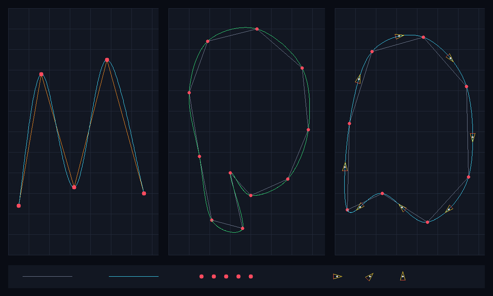

# Checkpoint 1 - Catmull-Rom Splines

This standalone Pure C++20 program demonstrates uniform Catmull-Rom spline
interpolation without OpenGL or another graphics library. It writes every pixel
to an in-memory RGB canvas, then saves the result as
`output/splines_demo.ppm` and a matching PNG preview.



## Build and run

From the repository root:

```bash
c++ -std=c++20 -Wall -Wextra -Wpedantic checkpoint1/splines/main.cpp -o /tmp/apex3d-splines
/tmp/apex3d-splines
```

The program runs deterministic self-checks before rendering. It exits with a
failure status if interpolation endpoints, degenerate input, collinearity or
canvas bounds behave incorrectly.

## Catmull-Rom equation

For four consecutive points `P0`, `P1`, `P2`, `P3`, one uniform Catmull-Rom
segment interpolates from `P1` to `P2`:

```text
P(t) = 0.5 * [
    2P1
    + (-P0 + P2)t
    + (2P0 - 5P1 + 4P2 - P3)t^2
    + (-P0 + 3P1 - 3P2 + P3)t^3
]
```

where `0 <= t <= 1`.

Unlike a Bezier curve, Catmull-Rom passes through its middle control points.
`P0` and `P3` influence the incoming and outgoing tangents. Adjacent segments
share points, making it convenient to turn a sequence of circuit waypoints into
a continuous path.

The analytic derivative is also evaluated. Its direction is used to orient the
small triangular car poses in the right panel.

## Image panels

The 1200 x 720 output contains three demonstrations:

1. **Open spline:** a raw orange polyline is compared with a cyan interpolating
   curve. Endpoints are handled by duplicating the first and last point.
2. **Monza-inspired closed path:** a green closed spline smooths a simplified
   set of circuit waypoints. Modular indexing supplies neighbours around the
   final-to-first join.
3. **Path orientation:** eight car poses are placed on a closed cyan spline.
   Each pose points along the analytic spline tangent, connecting CP1 curve work
   to the transformation and animation work planned for Checkpoint 2.

Red disks are the interpolated control points. Grey or orange lines show the
unsmoothed input polylines.

## Sampling and rasterisation

Each segment is evaluated at 120 uniformly spaced values of `t`. Consecutive
samples are rounded to pixels and joined using a handwritten all-octant
Bresenham line rasteriser. Uniform parameter sampling is easy to explain, but
does not produce constant physical speed along the curve.

## Project relevance

Apex3D begins with ordered Monza waypoints. Splines convert those angular
waypoints into a continuous racing line suitable for:

- smoothing the circuit centreline;
- positioning a Formula 1 car between waypoints;
- calculating a tangent for the car's heading;
- generating animation frames in Checkpoint 2.

## Deterministic checks

The executable verifies:

- `P(0) = P1`;
- `P(1) = P2`;
- identical control points produce a constant segment;
- collinear control points remain on the same line;
- out-of-canvas pixels are safely rejected.

## Known limitations

- The implementation uses the uniform Catmull-Rom formulation. Large
  differences between waypoint spacing can cause loops or overshoot; a
  centripetal parameterisation would reduce that risk.
- Samples are uniform in `t`, not arc length, so equal time steps do not imply
  equal travel distance.
- Lines are one pixel wide and aliased.
- The Monza coordinates are simplified, hand-authored evidence geometry rather
  than telemetry or GPS data.
- Car poses demonstrate position and heading only; timed animation belongs to
  Checkpoint 2.
