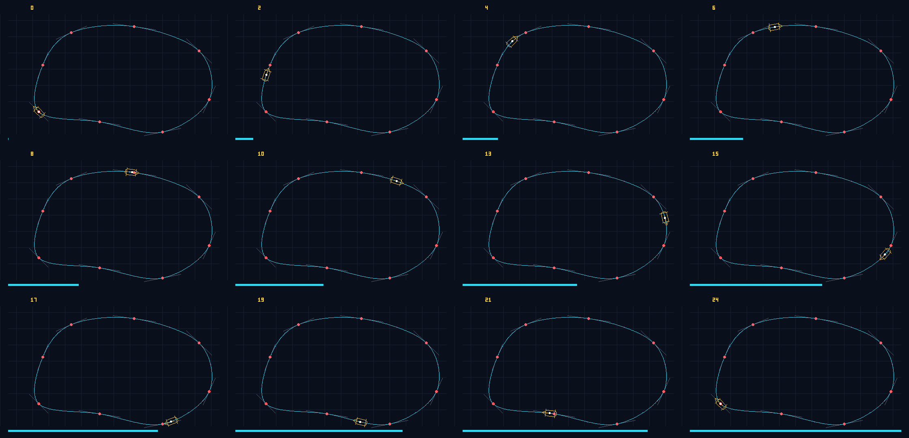

# Arc-length Bézier car motion

This Pure C++20 milestone animates the Apex3D Formula 1 car around a closed
eight-segment cubic Bézier circuit. It extends the Checkpoint 1 Bézier work by
adding analytic tangents, homogeneous transformations and approximately
constant-distance frame sampling.



## Project connection

Apex3D needs a path representation that can place and orient the car at every
animation frame. Cubic Bézier curves provide artist-controlled racing-line
segments, while the derivative supplies the car heading. The shared
`apex3d::Mat3` engine applies the resulting translation and rotation to every
vertex of the simplified vehicle.

This milestone complements the Catmull–Rom demonstration: both follow smooth
paths, but this implementation explicitly builds a chained cubic Bézier route
and adds an arc-length lookup table to reduce speed variation.

## Build, test and generate

Run from the repository root:

```sh
c++ -std=c++20 -Wall -Wextra -Wpedantic \
    checkpoint2/animation/bezier/tests.cpp \
    -o /tmp/apex3d-bezier-motion-tests
/tmp/apex3d-bezier-motion-tests

c++ -std=c++20 -Wall -Wextra -Wpedantic \
    checkpoint2/animation/bezier/main.cpp \
    -o /tmp/apex3d-bezier-motion-demo
/tmp/apex3d-bezier-motion-demo
```

The renderer writes 25 numbered P6 PPM frames and a 4 × 3 contact sheet. On
macOS, the evidence PNG can be regenerated with:

```sh
sips -s format png \
    checkpoint2/animation/bezier/output/bezier_contact_sheet.ppm \
    --out checkpoint2/animation/bezier/output/bezier_contact_sheet.png
```

The conversion command is evidence packaging only; all curve mathematics,
transformations and raster rendering are implemented in C++.

## Cubic Bézier mathematics

For control points `P0`, `P1`, `P2`, `P3` and parameter `t ∈ [0, 1]`:

```text
B(t) = (1−t)³P0 + 3(1−t)²tP1 + 3(1−t)t²P2 + t³P3

B′(t) = 3(1−t)²(P1−P0)
      + 6(1−t)t(P2−P1)
      + 3t²(P3−P2)
```

Eight circuit anchors are converted into a closed chain. For anchor `Ai`, the
segment from `Ai` to `Ai+1` uses:

```text
P0 = Ai
P1 = Ai   + (Ai+1 − Ai−1) / 6
P2 = Ai+1 − (Ai+2 − Ai)   / 6
P3 = Ai+1
```

The reflected handle relationship guarantees matching positions and first
derivatives at every join, including the final-to-first closure.

## Arc-length animation

Equal changes in Bézier parameter `t` do not normally travel equal distances.
The `ArcLengthTable` samples each segment 160 times and stores cumulative
distance against the global curve parameter `u`.

For a requested animation progress value:

1. Convert progress to target distance: `d = progress × totalLength`.
2. Find the two lookup samples surrounding `d`.
3. Interpolate their global parameters to estimate `u`.
4. Evaluate the Bézier position and derivative at `u`.

This produces approximately uniform motion without relying on a graphics or
animation library.

## Transformation

The local car model faces the positive X direction. At every frame:

```text
position = B(t)
heading  = atan2(B′y(t), B′x(t))
M        = Translation(position) × Rotation(heading)
worldVertex = M × localVertex
```

All car vertices use the same matrix. The white centre marker verifies the
translation, while the yellow nose shows tangent alignment.

## Verification

The deterministic suite checks:

- Bézier endpoint interpolation
- analytic derivative endpoint formulas
- C0 and C1 continuity at all eight joins
- monotonic and complete arc-length lookup construction
- exact lap closure for position and heading
- approximately uniform frame-to-frame travel
- matrix placement and tangent orientation
- finite poses and rendered centre pixels
- rejection of non-finite progress and invalid frame indices

The standard build and an AddressSanitizer/UndefinedBehaviorSanitizer build
both pass all checks.

## Output

- 25 frames: `output/frames/bezier_frame_00.ppm` through
  `bezier_frame_24.ppm`
- 560 × 360 RGB canvas per frame
- 2,240 × 1,080 PPM and PNG contact sheets
- eight cubic Bézier segments
- approximate circuit length of 1,145.44 pixels

## Known limitations

- Arc length is approximated numerically rather than solved exactly.
- Speed is approximately, not perfectly, constant between rendered frames.
- The circuit is a simplified hand-authored representation.
- Raster lines are one pixel wide and not anti-aliased.
- The car is a simplified top-view outline without racing physics or wheel spin.
- PNG conversion is a post-processing step; the C++ program writes PPM files.
