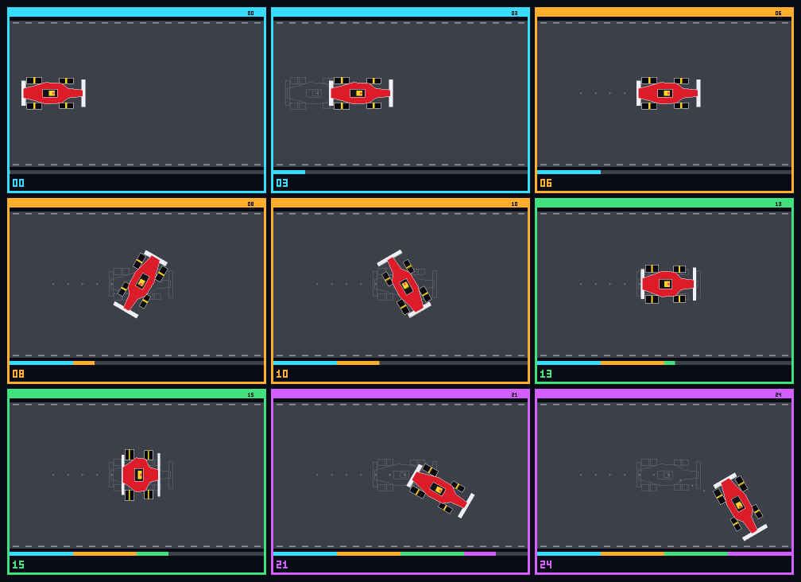

# Checkpoint 2: Polygon Formula 1 car animation

This Pure C++20 milestone animates the polygon Formula 1 car from
`checkpoint2/transformations` across 25 numbered frames. It combines two merged
milestones:

- **Polygon representation and scanline filling** (`checkpoint1/polygons`):
  each car part is an ordered vertex list, filled with the even-odd scanline
  rule and outlined with Bresenham lines.
- **Homogeneous transformations** (`checkpoint2/transformations`): every pose
  is a single `apex3d::Mat3` built from `translation`, `rotationDegrees` and
  `scaling`.

No OpenGL, GLFW, SFML, SDL, OpenCV or other graphics library is used. The
contact-sheet PNG is encoded by a small writer in the same header.



## Files

| Path | Purpose |
| --- | --- |
| `include/car_animation.hpp` | Car model, pose matrix, keyframe schedule, rasteriser, frame and contact-sheet rendering, PNG writer |
| `main.cpp` | Writes the numbered frames and the contact sheet, prints the pose table |
| `tests.cpp` | 11 deterministic tests |
| `output/frames/car_frame_00.ppm` … `car_frame_24.ppm` | 25 numbered 640 × 420 P6 frames |
| `output/car_contact_sheet.png` | PNG contact sheet (PPM copy alongside) |

The fill and line code repeats the Checkpoint 1 algorithms because
`checkpoint1/polygons/main.cpp` is a single file with its own `main()` and
cannot be included.

## Build, test and run

From the repository root:

```bash
c++ -std=c++20 -Wall -Wextra -Wpedantic checkpoint2/animation/car/tests.cpp -o apex3d-car-tests
./apex3d-car-tests

c++ -std=c++20 -Wall -Wextra -Wpedantic checkpoint2/animation/car/main.cpp -o apex3d-car-demo
./apex3d-car-demo
```

The demo writes into `checkpoint2/animation/car/output/`. Pass a directory as
the first argument to write somewhere else. Both programs compile with no
warnings (verified with GCC 16.2).

## One matrix per frame

The car is defined in local model coordinates with its nose towards `-y`. The
centre of its bounding box, `c = (0, 2)`, is the pivot. A pose is a position
`p`, a rotation angle `θ` and scale factors `(sx, sy)`:

```text
M = T(p) · R(θ) · S(sx, sy) · T(-c)
```

With column vectors the rightmost matrix acts first:

1. `T(-c)` moves the car centre to the origin.
2. `S(sx, sy)` scales across (`sx`) and along (`sy`) the car.
3. `R(θ)` rotates about the origin, which is now the car centre.
4. `T(p)` places the centre at `p`.

Because the centre is at the origin while scaling and rotating, it stays fixed:
`M · c = p` for every pose. This is the same as the shared helper
`T(p - c) · aroundPivot(R, c)`, and a test checks the two give the same matrix.

`placeCar(model, M)` sends every one of the 13 components through `M`:

| Group | Components |
| --- | --- |
| Chassis | 1 polygon, 12 vertices |
| Wings | front wing, rear wing |
| Tyres | front-left, front-right, rear-left, rear-right |
| Wheel stripes | one per tyre |
| Cockpit | 1 rectangle |
| Helmet | 1 rectangle |

Each `PlacedComponent` stores a copy of the matrix it received, so the tests
can check that all 13 match. Transformations preserve vertex order and count,
so a 12-vertex chassis is still a 12-vertex polygon on screen. Screen `y`
points down, so a positive angle turns the car clockwise. `θ = 90°` points the
nose to the right.

## Animation schedule

Keyframes are interpolated linearly (`lerp`) for position, angle and scale:

| Frames | Phase | What changes |
| --- | --- | --- |
| 00 → 06 | Translation | centre (110, 210) → (330, 210), 36.7 px per frame |
| 06 → 12 | Rotation about centre | θ 90° → 450° (one full turn, 60° per frame) |
| 12 → 15 → 18 | Non-uniform scaling | (1, 1) → (1.6, 0.6) → (1, 1) |
| 18 → 24 | Translation + rotation | centre → (510, 290) while θ 450° → 510° |

Angles are not wrapped to `[0, 360)`, which keeps interpolation continuous.
450° is drawn the same as 90°. Frames outside `0 … 24` are clamped.

## Reading the frames

- **Header band:** colour of the current phase (cyan translation, orange
  rotation, green scaling, purple combined), with the frame number. These are
  the same colours as the panels in `checkpoint2/transformations`.
- **Grey ghost outline:** the pose at the start of the current phase, so each
  frame shows the change relative to where that phase began.
- **Grey dots:** the centre position of every earlier frame.
- **Red dot:** the pivot (car centre). It does not move during rotation or
  scaling.
- **Bottom bar:** progress through the animation, coloured by phase.

The contact sheet shows frames 00, 03, 06, 08, 10, 13, 15, 21 and 24 at half
size (2 × 2 box filter). Each tile border uses its phase colour.

## Deterministic tests

`tests.cpp` checks:

- **First pose:** frame 0 pose and hand-computed vertices, e.g. chassis
  nose `(-8, -72) → (184, 202)`.
- **Middle pose:** frame 12 is `(330, 210)` at 450°, and it matches frame 6
  after a full turn.
- **Final pose:** frame 24 vertex at 150°, written with exact `√3` terms.
- **Clamping and keyframes:** frames below 0 and above 24 clamp, and each
  keyframe is reproduced exactly.
- **Translation:** every vertex of every component shifts by the same offset.
- **Centre-pivot rotation:** `M · c = p` for frames 6–12. The matrix equals the
  `aroundPivot` formulation, and each vertex keeps its distance from the pivot.
- **Non-uniform scaling:** the front wing is 1.6× wider and 0.6× deeper at
  frame 15, with the centre still fixed.
- **Vertex counts:** 13 components and every vertex count unchanged in all 25
  frames.
- **Same matrix:** in every frame each component's stored matrix equals the
  frame matrix, and each vertex equals `M · model vertex`.
- **Rendered pixels:** pivot, chassis and track colours at known pixels.
- **PNG encoder:** signature and the fixed `IEND` chunk CRC.

## Project relevance

Apex3D replays a Formula 1 car moving around a circuit. Every later motion
feature, including timeline playback, Bézier and Catmull-Rom path following
and wheel animation, needs the car to be placed by one pose matrix so its
parts never separate. This milestone shows that rule working on the full car
model before path-following and OpenGL rendering are added.

## Known limitations

- 2D only. Cameras, perspective and 3D meshes are left for the OpenGL
  checkpoint.
- Interpolation is linear with no easing. Path-driven motion comes from the
  Bézier and Catmull-Rom milestones.
- Edges are one-pixel Bresenham lines with no anti-aliasing.
- The PNG writer uses uncompressed deflate blocks, so the contact sheet is
  about 2.2 MB.
- Scaling also distorts the wheels. It is a transformation demo, not
  physical behaviour.
- Fill and line code is duplicated from Checkpoint 1 because that milestone
  cannot be included as a library.
