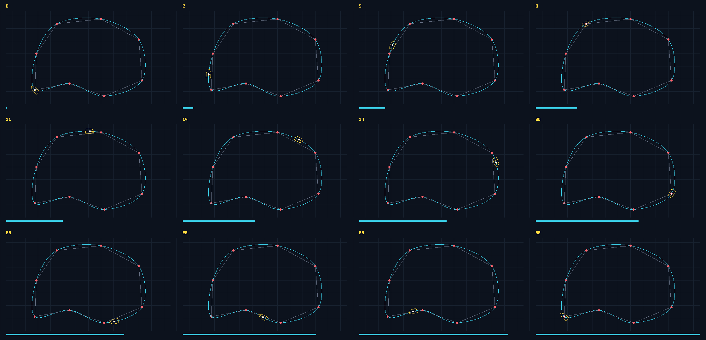

# Closed Catmull–Rom car motion

A Pure C++20 path-following animation for Apex3D's racing circuit. It builds on
`checkpoint1/splines/main.cpp`: the uniform Catmull–Rom position and analytic
first derivative formulas are retained in `include/spline_motion.hpp`. The car
uses the existing `apex3d::Mat3` engine; raster drawing reuses the wheel milestone's
canvas and Bresenham implementation. No graphics library is required.



## Build, test, generate

Run from the repository root:

```sh
c++ -std=c++20 -Wall -Wextra -Wpedantic checkpoint2/animation/splines/tests.cpp -o /tmp/apex3d-spline-tests
/tmp/apex3d-spline-tests
c++ -std=c++20 -Wall -Wextra -Wpedantic checkpoint2/animation/splines/main.cpp -o /tmp/apex3d-spline-demo
/tmp/apex3d-spline-demo
sips -s format png checkpoint2/animation/splines/output/spline_contact_sheet.ppm --out checkpoint2/animation/splines/output/spline_contact_sheet.png
```

`sips` is the macOS system image converter, used only after C++ rendering.
On other platforms, any PPM-to-PNG converter can perform this final step.
An optional first demo argument selects another output directory.

## Algorithm and transformation mathematics

For each segment, controls are P0 = points[i−1], P1 = points[i],
P2 = points[i+1], P3 = points[i+2]. Indices use `(i % N + N) % N`,
including negative indices, so the last segment interpolates the last control
and the first control without duplicating controls.

With A = 2P0 − 5P1 + 4P2 − P3 and B = −P0 + 3P1 − 3P2 + P3:

```text
C(t)  = 0.5 [2P1 + (P2−P0)t + At² + Bt³]
C′(t) = 0.5 [(P2−P0) + 2At + 3Bt²]
heading = atan2(C′y, C′x)
M = Translate(Cx, Cy) · Rotate(heading)
worldVertex = M · localVertex
```

The model faces local +X. Rotation is converted to degrees for Mat3's API.
Screen Y increases downward, so positive angles turn clockwise. The car centre
and every body vertex follow the same matrix. This combines interpolation,
analytic differentiation and homogeneous transformations into circuit motion.

A global parameter u counts segments: wrap u modulo 8, take floor(u) as the
segment and its fractional part as t. It supports negative time and repeated
laps. Frame f uses u = 8f/32. There are 33 numbered 560 × 360 P6 frames,
`00` through `32`; frame 00 starts at (110, 285), and frame 32 returns there
with the same tangent and heading. For seamless playback, play frames 00–31
and repeat; frame 32 is the explicit closure sample.

The control polyline is grey, controls red, smooth spline cyan and car yellow
with a white centre. A frame number and lap progress bar identify each sample.
The 4 × 3 PNG contact sheet shows frames 0, 2, 5, 8, 11, 14, 17, 20, 23,
26, 29 and 32, covering the complete lap.

## Verification and limitations

Deterministic tests check every segment's P1/P2 endpoints, negative and positive
index wrapping, repeated laps, finite non-zero tangents, analytic derivatives
against central differences, the exact first and final frame positions, and
heading continuity on both sides of all joins including closure. Heading
differences are compared modulo 2π because atan2 has a numerical branch cut.
Tests also check matrix centre placement, forward-axis alignment and the
rendered centre pixel in every frame. Both builds pass the required warning flags.

Uniform parameter steps are not constant arc-length speed. The fixed circuit
has non-zero tangents; arbitrary degenerate user-supplied controls are not
supported. The spline is C1 at joins but curvature need not be continuous.
Raster outlines are aliased, the car is a simple top-view model, and no racing
physics or wheel spin is simulated. Shared matrix and raster headers remain
external read-only dependencies. Algorithm notes are kept here to respect the
restriction that all changes stay inside this directory.
