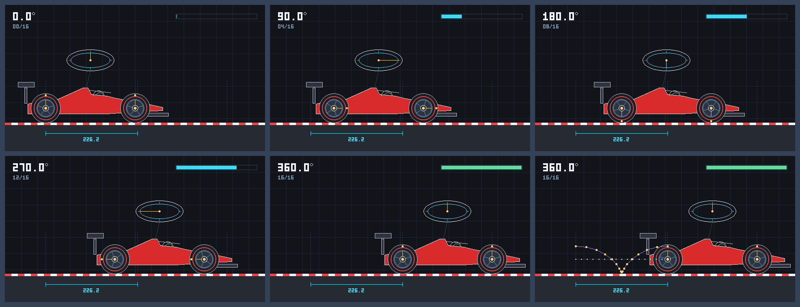

# Checkpoint 2: Formula 1 wheel animation

This Pure C++20 milestone animates a side-view Formula 1 car. Each wheel spins
about its own centre while the car body carries it along the track, rolling
without slipping. It combines two merged milestones:

- **Midpoint circles and ellipses** (`checkpoint1/circles`): every tyre, band,
  rim, hub, marker, telemetry ellipse and helmet arc is rasterised with the same
  integer midpoint decisions.
- **Homogeneous transformations** (`checkpoint2/transformations`): every moving
  point is produced by `apex3d::Mat3`, including `aroundPivot`.

No OpenGL or third-party library is used.



## Files

| Path | Purpose |
| --- | --- |
| `include/raster.hpp` | Canvas, Bresenham lines, midpoint circle and ellipse, filled midpoint disc, polygon fill, HUD digit font |
| `include/wheel_animation.hpp` | Wheel, telemetry pod and car models, pose functions, frame and contact-sheet rendering |
| `main.cpp` | Writes the numbered frames and the contact sheet |
| `tests.cpp` | Deterministic geometry and raster tests |
| `output/frames/wheel_frame_00.ppm` … `wheel_frame_16.ppm` | 17 numbered 640 × 360 P6 frames |
| `output/wheel_contact_sheet.png` | PNG contact sheet (PPM source alongside) |

The midpoint circle and ellipse code is repeated in `raster.hpp` with identical
decisions, because the Checkpoint 1 milestone is a single file with its own
`main()` and cannot be included.

## Build, test and run

From the repository root:

```bash
c++ -std=c++20 -Wall -Wextra -Wpedantic checkpoint2/animation/wheels/tests.cpp -o /tmp/apex3d-wheel-tests
/tmp/apex3d-wheel-tests

c++ -std=c++20 -Wall -Wextra -Wpedantic checkpoint2/animation/wheels/main.cpp -o /tmp/apex3d-wheel-demo
/tmp/apex3d-wheel-demo
```

The demo writes into `checkpoint2/animation/wheels/output/`; pass a directory
as the first argument to write elsewhere. Convert the contact sheet to PNG with
Pillow (or `ffmpeg` / `magick` as in the Checkpoint 1 README):

```bash
py -c "from PIL import Image; Image.open('checkpoint2/animation/wheels/output/wheel_contact_sheet.ppm').save('checkpoint2/animation/wheels/output/wheel_contact_sheet.png', optimize=True)"
```

## Animation schedule

| Quantity | Value |
| --- | --- |
| Frames | 17 (`00` … `16`), one full revolution |
| Step | 360 / 16 = 22.5° per frame |
| Key frames | `00` = 0°, `04` = 90°, `08` = 180°, `12` = 270°, `16` = 360° |
| Tyre radius `r` | 36 px |
| Travel per frame | r · 22.5° in radians ≈ 14.14 px |
| Travel per revolution | 2πr ≈ 226.2 px (dimension line under the track) |

Rolling without slipping links the two motions: the body translation is the
arc length the tyre has turned through, `d = r·θ`. Screen coordinates have
`y` pointing down, so a positive angle in `Mat3::rotationDegrees` turns
clockwise on screen, which is forward rolling for a car moving right.

## Transformation model

The body-local origin is the rear-wheel centre. For frame angle θ:

```text
Body(θ)  = Translate(startX + r·θ, groundY − r)
Wheel(θ) = Body(θ) · Translate(mount) · Rotate(θ) · Translate(−mount)
```

The rightmost factors spin the wheel about its own mount (the pivot), then the
body matrix moves the whole spinning wheel. The chassis polygons, helmet and
telemetry pod use `Body(θ)` only.

### Wheel components

| Component | Primitive | Radius |
| --- | --- | --- |
| Tyre (filled rubber, silver outline) | filled midpoint disc + midpoint circle | 36 |
| Soft-compound band | two midpoint circles, red | 28, 29 |
| Rim face and lip | filled disc + midpoint circle | 22 |
| Rim barrel | midpoint circle | 20 |
| Five spokes, spoke 0 in yellow | Bresenham lines, hub → barrel | 7 → 20 |
| Hub and lock nut | midpoint circle, filled disc | 7, 3 |
| Compound marker | filled midpoint disc on a 32 px orbit | 2 |

The yellow spoke and the yellow compound marker are the rotation reference:
they point up at 0°, right at 90°, down at 180°, left at 270° and up again at
360°. Tyre and rim radii used for drawing are *measured* from transformed
points (`|M·(c + (r,0)) − M·c|`), so a transformation that distorted the wheel
would show up both in the image and in the tests.

The filled discs reuse the midpoint circle's first-octant points and join each
symmetric pair with a horizontal span, so the fill boundary is exactly the
midpoint outline.

### Elliptical telemetry pod

The pod is mounted on the chassis by a tether and therefore translates with
the body but never rotates; this keeps it axis-aligned, which is what the
midpoint ellipse rasterises. Outer ellipse 58 × 26 (white), inner ellipse
48 × 18 (cyan). Its yellow needle shows the wheel angle by placing the unit
"12 o'clock" vector on the inner ellipse:

```text
needleTip = Body(θ) · Translate(podCentre) · Scale(48, 18) · Rotate(θ) · (0, −1)
```

The driver's helmet is an upper-half midpoint ellipse fixed to the body.

## Frames and contact sheet

Each frame shows a static grid and kerb (so translation is visible against a
fixed background), dashed guides at the start and end hub positions, the
moving car, the angle in degrees, the frame counter and a progress bar that
turns green on the 360° frame.

The contact sheet is a 3 × 2 grid. Tiles 1–5 are frames 00, 04, 08, 12 and 16
(0°, 90°, 180°, 270°, 360°). Tile 6 is frame 16 overlaid with the rear hub
position (white dots, a straight line: the pivot only translates) and the
compound marker position (yellow dots joined in purple) for all 17 frames;
the marker traces a curtate cycloid, the expected path of a point inside a
rolling wheel.

## Deterministic tests

`tests.cpp` checks, using a test wheel mounted away from the origin so a pivot
mistake would be detected:

- **Schedule:** at least 16 frames; key frames are 0, 90, 180, 270, 360°.
- **0° rotation:** the wheel matrix is the identity and every point is unchanged;
  the marker pixel is drawn directly above the hub.
- **90° rotation:** marker, spoke 0 and tyre reference move a quarter turn
  clockwise; marker pixel is right of the hub.
- **180° rotation:** marker below the hub; tyre reference on the left.
- **270° rotation:** marker left of the hub.
- **360° rotation:** every point returns to its initial coordinates and pixel,
  and the rendered wheel is pixel-identical to the 0° wheel; frame 16 equals
  frame 0 shifted by 2πr (within 1e-9).
- **Pivot fixed:** the centre is unchanged for angles −720° … 720° in 7.5°
  steps, the hub pixel keeps its colour in every frame, and in the animation the
  hub stays at the body's mount point at constant height.
- **Translation affects the entire wheel:** every point (centre, references,
  marker, all spoke ends) moves by the same vector for several angles and
  translations; the rendered wheel is the same image shifted; body, both
  wheels and the pod advance by the same `r·Δθ` each frame.
- **Radii unchanged:** measured tyre (36), rim (22) and marker-orbit (32)
  distances in every frame for both wheels; rendered tyre and rim bounding
  boxes are `2r + 1` pixels wide and high; telemetry ellipse radii are 58 × 26
  and the rendered ellipses are `(2rx + 1) × (2ry + 1)` in every frame.
- **Telemetry needle** lies on the inner ellipse; **rolling distance** is `r·θ`.

## Known limitations

- The wheel is shown in side view, so it is a true circle. A wheel seen at an
  angle would be a rotated ellipse, which the axis-aligned midpoint ellipse
  cannot draw.
- Outlines are aliased one-pixel lines; there is no motion blur, so at 22.5°
  per frame the five-fold spoke pattern can look ambiguous. Use the yellow
  spoke and marker to read the angle.
- Wheel-to-pixel rounding happens per point, so spokes can differ by one pixel
  between angles that are geometrically equivalent.
- The car moves at constant speed on a straight, flat track. Path following
  along splines is a separate CP2 milestone.
