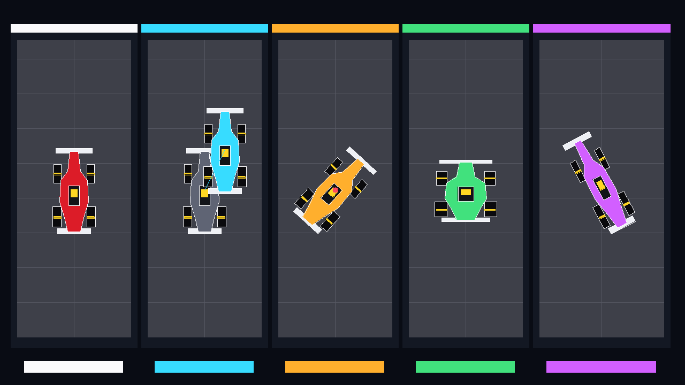

# Pure C++ 2D transformation foundation

This Checkpoint 2 milestone implements 3 x 3 homogeneous transformation
matrices directly in C++20 and applies them to the Apex3D Formula 1 car. It uses
no OpenGL or external graphics library.



## Build, test and run

From the repository root:

```bash
c++ -std=c++20 -Wall -Wextra -Wpedantic checkpoint2/transformations/tests.cpp -o /tmp/apex3d-transform-tests
/tmp/apex3d-transform-tests

c++ -std=c++20 -Wall -Wextra -Wpedantic checkpoint2/transformations/main.cpp -o /tmp/apex3d-transform-demo
/tmp/apex3d-transform-demo
```

The renderer writes `checkpoint2/transformations/output/transformations_demo.ppm`.
A matching PNG preview is committed for GitHub and checkpoint evidence.

## Homogeneous coordinates

A 2D point `(x, y)` is represented as the column vector `(x, y, 1)`. This lets
translation, rotation and scaling use the same 3 x 3 matrix interface.

Translation:

```text
[ 1  0  tx ]
[ 0  1  ty ]
[ 0  0   1 ]
```

Scaling:

```text
[ sx  0   0 ]
[  0 sy   0 ]
[  0  0   1 ]
```

Rotation by angle `theta`:

```text
[ cos(theta)  -sin(theta)  0 ]
[ sin(theta)   cos(theta)  0 ]
[     0             0       1 ]
```

The implementation uses column vectors. In a product `T * R * S`, scaling is
applied first, followed by rotation and then translation.

## Pivot transformations

To rotate or scale around a point `p` rather than the origin:

```text
M = Translate(p) * Transform * Translate(-p)
```

The test executable verifies this with a 90-degree rotation around `(5, 5)`.

## Evidence image

The five panels are ordered left to right:

1. **Original:** unmodified polygon-based Formula 1 car.
2. **Translation:** grey source pose and cyan translated pose, connected by a
   displacement line.
3. **Rotation:** orange car rotated 42 degrees around the red centre pivot.
4. **Scaling:** green car scaled wider and shorter using non-uniform scaling.
5. **Combined:** purple car scaled, rotated and translated through matrix
   composition.

The car reuses Checkpoint 1 polygon representation and scanline filling.
Chassis, wings, tyres, wheel stripes, cockpit and helmet are transformed as
separate polygons by the same matrix.

## Deterministic tests

`tests.cpp` verifies:

- identity transformation;
- translation;
- positive and negative scaling;
- 90-degree rotation;
- combined scale, rotate and translate order;
- rotation around a pivot;
- polygon vertex-count preservation;
- transformed polygon coordinates.

## Known limitations

- This milestone is 2D. Perspective, cameras and 3D matrices belong to the
  later OpenGL integration checkpoint.
- The renderer exports a static comparison image. Timed animation frames are
  the next CP2 milestone.
- Polygon edges are one-pixel Bresenham lines without anti-aliasing.
- Matrix inversion and shearing are not implemented yet.
- The car is a simplified top-down model rather than a physical vehicle mesh.
