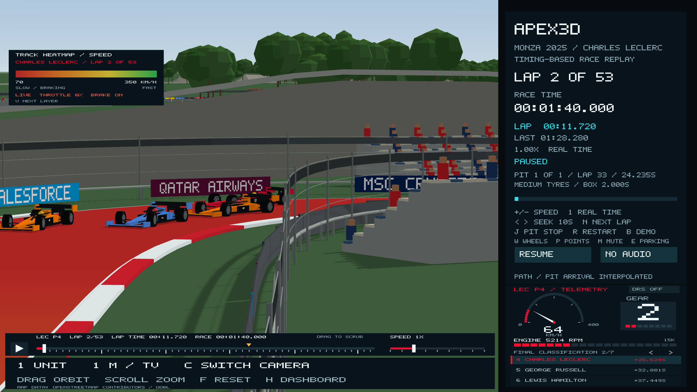

# Apex3D architecture

## Race state and 3D rendering

```text
FIA timing CSV -> generated integer-ms data -> 53-lap race/sector boundaries
Real frame delta -> ready/start/pause/rate/seek/finish -> race clock
    -> current/last lap, sector/pit keyframes and unwrapped progress
    -> CP2 Catmull-Rom or Bezier position + tangent
    -> metre-space 3D pose: (path.x * metres/unit, road height, -path.y * metres/unit), yaw from tangent
    -> solid F1-style car, rotating tyres and optional service crew

Static sampled route -> raised track/kerbs, barriers and parkland
Pit route -> road ribbon, service box, garages and pit wall
Starting state -> 3D gantry lamps + compact screen-space lamp display

3D mesh normals + directional sunlight -> lit material shader
Static/dynamic meshes -> directional light-space depth map -> filtered shadows
Camera -> perspective x look-at matrix -> depth-tested scene viewport
Race dashboard and camera hints -> screen-space overlay, depth disabled
```

The historical replay clock and pit assumptions are independent of the renderer.
All sector and lap crossings retain their documented times. Intra-sector motion,
pit geometry and box-arrival splits remain interpolated; they are not a GPS,
continuous speed-telemetry or full-field simulation. See `monza-race-research.md`.

The app starts Ready and muted. Space or START begins the illustrative real-time
6.5-second five-light sequence. The race clock starts at lights-out and supports
0.25x–64x, pause, seeking and an exact 4,404.325-second finish. Seeking reconstructs
state directly without replaying old start cues. There is no Monza lap 54.

## Meshes and world coordinates

The Monza centreline is generated from recorded OpenF1 positions
(`generated/monza_track_2025.hpp`, see [measured track geometry](real-track-geometry.md)).
`physical_scale.hpp` calibrates it to 5,793 metres.
`scene3d.hpp` converts it into metre-space X/Z positions with Y up. Road width,
car wheelbase, tyres and scenery use explicit physical dimensions. The 12 m
road and representative 2 m car width therefore share the same scale. See
[Physical scale](physical-scale.md) for sources, estimates and accuracy limits.

The car is a procedural solid model with a lofted monocoque/nose, wings,
suspension rods, 720 mm cylindrical tyres, 18-inch rims, cockpit, helmet,
airbox and halo. The artistic body template is resized into a representative
2025 envelope; normals use the inverse scale before tangent rotation. Tyres
are constructed directly in metres and placed at a 3.6 m wheelbase.

`RaceMotion` integrates the reconstructed pit path once. Rendered wheel spin
and the inspector RPM use its travelled metres, including the bay excursion;
service time freezes both. The fast-lane mesh and the separate car trajectory
are built from the same pit model. Procedural crouched crew figures appear
during stationary service. Loaded tyre deformation and differential wheel
speeds are not simulated.

The scene is built flat. The lit and shadow vertex shaders then lift every vertex
by a height map made from the recorded track elevation (`terrain.hpp`), so the
road and everything on it follow the measured rise and fall. Cameras use the same
map on the CPU. Raised surfaces and buildings are model geometry, not a surveyed
Monza architecture dataset. No new external model, texture or rendering dependency
is required. The sun direction is the real solar position for the race time
(`sun_position.hpp`).

## Perspective, depth, light and shadows

`math3d.hpp` provides column-major 4x4 matrices, perspective/orthographic projection,
look-at, vector operations and camera frames. Matrices are uploaded with no
transpose. `renderer3d.hpp` owns its shader programs, vertex buffers and depth
framebuffer and destroys them while the OpenGL context is still current.

The renderer draws a directional light-space depth pass, then a perspective lit
scene with depth testing. Vertex normals drive ambient/diffuse/specular lighting.
A 4096-square directional shadow map uses a 3x3 depth comparison filter and slope
bias; unavailable shadow buffers fall back to directional lighting. Four-sample
MSAA is requested. The dashboard is drawn last in the full-window viewport with
depth testing disabled, keeping its clocks and controls legible. Screenshot
modes use a hidden GLFW context and suppress macOS menu creation so evidence
capture does not take over the active preview.

## Cameras and interaction

- Overview: orbit the whole course; drag adjusts yaw/pitch and scroll changes distance.
- Chase: follow the car with a smoothed eye/target; drag orbits the car. Seeking and
  mode changes reset smoothing to avoid flying across the course.
- Cockpit: a driver-height perspective looking forward through the halo; scroll
  adjusts field of view. Dragging transitions to the external chase/orbit view.
- TV: fixed trackside camera towers, like the broadcast coverage
  (`tv_camera.hpp`).
  - **Towers:** one every 200 m, 13.4 m from the centreline (behind the catch
    fence, in front of every grandstand), with the lens 7 m up on an arm. They
    stand on the outside of corners, and on the straights on the side away from
    the pit lane. A tower is moved along the track if it would land on the old
    banking.
  - **Cuts:** worked out once for the whole lap. At each point the director
    uses the nearest tower to a spot 40 m ahead of the car, provided its line
    of sight to the car clears every tree by 4.5 m. Shots shorter than 45 m are
    merged, giving about 30 cuts a lap.
  - **Lens:** the field of view keeps about 22 m of track in shot at the car,
    and scroll changes that.
  - **What's representative:** the real broadcast camera plan isn't public, so
    tower positions are representative.



`C` cycles cameras, `F` resets the current view and `H` hides/shows the dashboard.
The 3D viewport expands when the dashboard is hidden. The race controls and
clickable mute/playback buttons remain available in the narrower sidebar.
Mouse hit regions use the inverse of the overlay's horizontal transform. GLFW
cursor events provide coordinates for both hit testing and dragging, including
retina/targeted desktop input. Sticky key/mouse states preserve short presses.

## Separate Bezier teaching route

`B` switches to the Monza Bézier chain and resets playback. That route
also renders in 3D but retains its separate 18-second teaching lap, optional
looping, scaling and anchors. It has no historical race timings or pit visit.
Switching back to Monza restarts its lights and documented race schedule.

## Source map

| Path | Responsibility |
| --- | --- |
| `src/main.cpp` | GLFW input/context, race/audio transitions, view selection, capture and frame loop |
| `include/apex3d/math3d.hpp` | 3D vectors, projection and look-at matrices |
| `include/apex3d/scene3d.hpp` | World/car/crew/gantry meshes, normals and camera rig |
| `include/apex3d/renderer3d.hpp` | Lit/depth shaders, mesh buffers, shadow framebuffer and rendering passes |
| `include/apex3d/hud3d.hpp` | Sidebar transform, inverse hit testing, camera hints and compact start overlay |
| `include/apex3d/race_weather.hpp` | Recorded trackside weather reading at a race time and its panel text |
| `include/apex3d/timing_tower.hpp` | Live running order and gaps from the position feed and sector timing lines; final classification after the race |
| `include/apex3d/cp3_scene.hpp` | Original route sampling, 2D track/car foundations and shared model scale |
| `include/apex3d/cp3_race.hpp` | Historical race clocks, sector/pit keyframes and reconstructed pit route |
| `include/apex3d/cp3_playback.hpp` | Start/pause/rate/seek/finish and separate demo playback |
| `include/apex3d/cp3_hud.hpp` | Bitmap text, race dashboard, clocks, buttons and fixed-body wheel inspector |
| `include/apex3d/cp3_start_audio.hpp` | Optional muted-by-default CC0 start cues on macOS |
| `data/monza-2025-verstappen.csv` | Inspectable timing facts in integer milliseconds |
| `tools/generate_race_assets.py` | Reproducible embedding/check of timing and PCM inputs |
| `tests/scene3d_tests.cpp` | Projection, normals, volume, tyre contact, wheel motion, cameras and HUD mapping |
| `tests/cp3_scene_tests.cpp` | Existing path, transformations and teaching-mode integration |
| `tests/cp3_race_tests.cpp` | All laps/sectors, pit service/joins, lights, mute, seeking and finish |

Hosted CI, lecturer-rubric alignment, group review and submission remain separate
from the verified local implementation. The visualization uses procedural assets
and reconstructed motion rather than production simulator physics or telemetry.

## Recorded telemetry and the podium extension

`recorded_motion.hpp` integrates each driver's archived speed trace, then
normalizes it within the exact sector/pit timing keys. `race_field.hpp` provides
independent Norris and Piastri timelines, sourced sector data and pit visits.
Their orange cars share the same metre-scale geometry. `driver_focus.hpp`
selects one driver for camera framing, lap/pit state and the graphic telemetry panel. `race_telemetry.hpp` holds the last source observation for
the speed/gear/engine-RPM panel, with an explicit stale-sample limit. Engine
RPM is not derived from wheel RPM or multiplied by playback rate.

The grandstand CSV generates the 37-entry placement table, keyed to the official
2025 map's corner areas and sides. Footprints remain modeled estimates. Overview
markers project each car through the current camera matrix into the actual
scene viewport, with a constant screen size; the focused marker draws last.
Zooming the overview moves its target towards the focus car before reaching
close scale. See `podium-telemetry-grandstands.md` for sources and limitations.

`WindowInput` stores the selected driver and queues discrete HUD actions from
the mouse callback. Podium rows have their own bounds and hover/selection state.
Focus changes invalidate camera smoothing without seeking or changing playback.
Only one overview marker is submitted. `race_telemetry.hpp` reads the selected
archive, and gauge geometry uses the same exact observation as the numbers.

`tyre_state.hpp` selects the archived stint at modeled service completion and
combines its prior age with completed laps on that set. The inspector, dashboard
compound and 3D tyre marker all read this same state.
