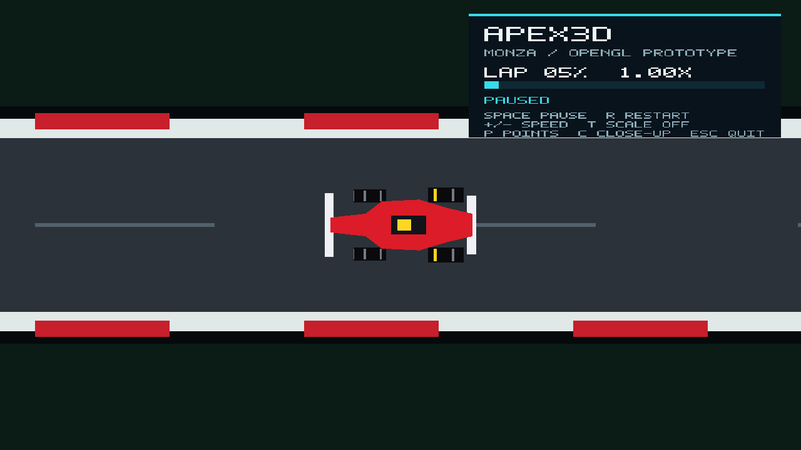
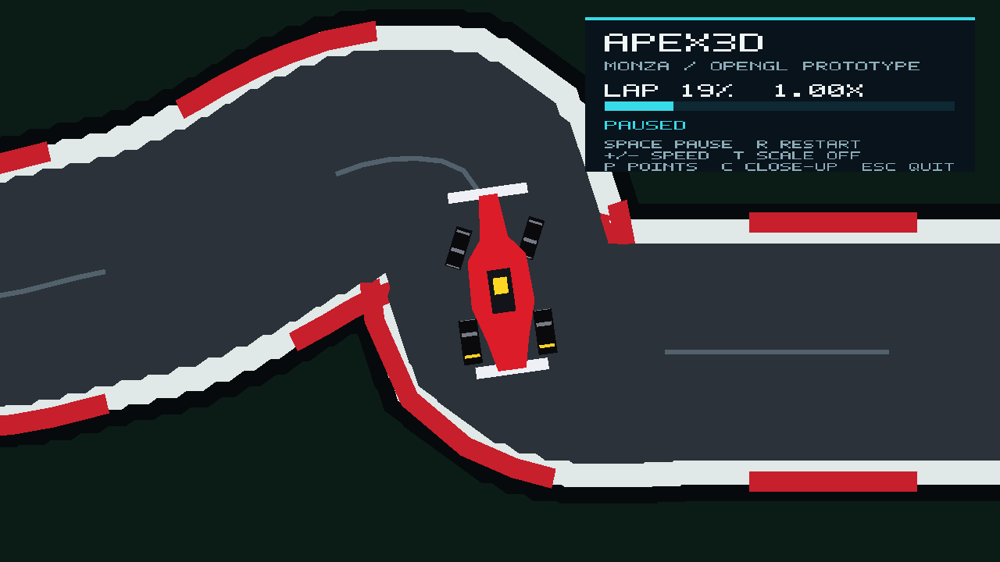

# Checkpoint 3 Progress

Checkpoint 3 asks the group to integrate previous components into an OpenGL
prototype. The current branch contains the first working integration milestone.

| Item | Status | Evidence |
| --- | --- | --- |
| OpenGL application window and shaders | Complete | `src/main.cpp` creates a GLFW window and OpenGL 3.3 context. |
| Filled Monza surface | Complete | `include/apex3d/cp3_scene.hpp` builds a layered triangle mesh from the original Monza points. |
| CP2 curve integration | Complete | The scene calls the CP2 Catmull-Rom position and tangent functions. |
| CP2 transformation integration | Complete | The car's pose uses the shared 3 x 3 matrix for translation, rotation and optional scaling. |
| CP2 polygon-car integration | Complete | The CP2 car components are triangulated and rendered in OpenGL. |
| Live lap animation | Complete | Distance-based path lookup updates the car every frame, approximately evenly along the circuit. |
| Interaction and feedback | Complete | Play/pause, restart, speed, scale demonstration, points toggle and an in-window lap display. |
| Source and visual verification | Complete | `ctest --test-dir build --output-on-failure` and `docs/evidence/cp3-opengl-prototype.png`. |
| Wheel hierarchy in the live scene | Complete | `include/apex3d/cp3_wheels.hpp` attaches four wheels with the CP2 `wheelTransform` hierarchy; the front pair steers from path curvature and tread bars roll at the rolling-without-slipping rate. Checked by `tests/cp3_wheel_tests.cpp`; see `docs/evidence/cp3-wheels-chicane-closeup.png`. |
| Bézier path as a selectable live route | Pending | The CP2 Bézier demonstration remains separate. |
| Group explanation and final submission evidence | Pending | Prepare after the lecturer publishes the combined checkpoint specifics. |

## Run the prototype

```bash
cmake -S . -B build
cmake --build build --parallel
ctest --test-dir build --output-on-failure
./build/Apex3D
```

Press `C` for a close-up camera that follows the car, which makes the wheel
motion readable. The same view can be captured from the command line:

```bash
./build/Apex3D --screenshot-closeup-at 0.195 chicane.ppm
```

## Wheel animation in the live car

The wheel milestone from CP2 (`checkpoint2/animation/wheels`) is now part of
the OpenGL car rather than a separate side-view demonstration:

- **Attachment.** The four wheel mounts are measured from the CP2 polygon-car
  tyre rectangles. Each wheel's matrix is the CP2 hierarchy
  `M_car * T(mount) * R(angle) * T(-mount)`, produced by the CP2
  `wheels::wheelTransform` function, so a wheel turns about its own centre
  while moving, turning and scaling with the body.
- **Steering.** The front pair yaws by `atan(wheelbase * curvature)`, limited
  to 25 degrees, where curvature is the change in path heading across 0.06
  world units around the car. The rear pair never steers.
- **Spin cue for a top-down view.** From above, a wheel's spin axis lies in
  the screen plane, so the rotation is shown as six tread bars rolling over the
  top of each tyre from the rear edge to the front. A bar at angle `phi` from
  top-dead-centre is drawn at `-r sin(phi)` along the tyre with thickness
  proportional to `cos(phi)`, and only the upper half is visible. Bar 0 is
  yellow so the wheel angle can be read, as with the highlighted spoke in CP2.
- **Rolling without slipping.** Spin equals lap distance divided by tyre
  radius, rounded to a whole number of revolutions per lap so the pattern
  lines up at the start/finish line (about 0.5% from the exact rate).

| Straight (no steering) | Rettifilo chicane (front wheels at full lock) |
| --- | --- |
|  |  |

At normal zoom the car is about 30 pixels long, so the tread bars are only
readable in the close-up view. At high playback speeds the bars can appear to
move backwards; this is ordinary temporal aliasing at 60 frames per second.

The app is currently a 2D top-down prototype, not the final 3D visualisation.
Its path and car are simplified and hand-authored; telemetry, perspective,
lighting and detailed scene assets are still future work.
