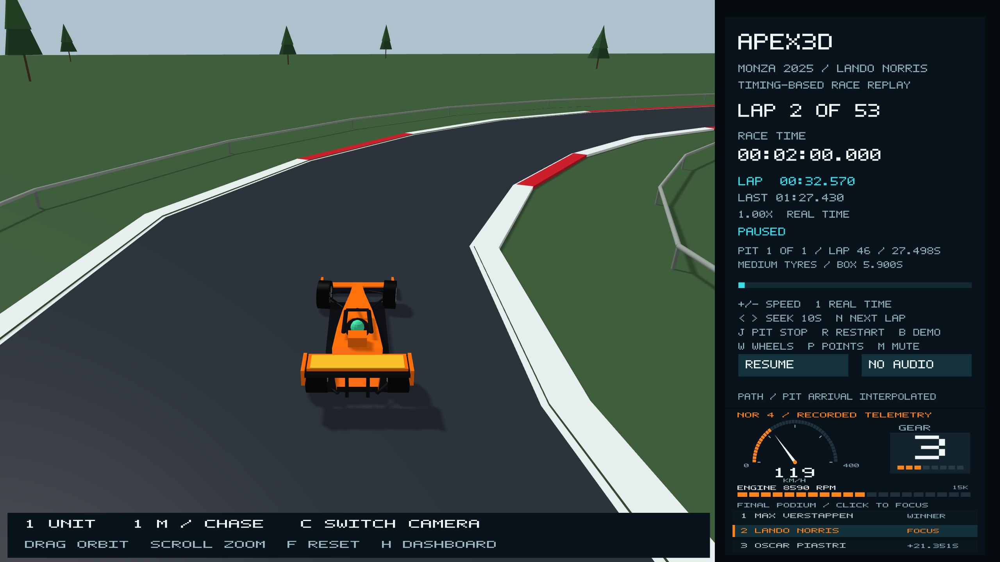

# Driver focus and graphic telemetry



Use the arrows beneath the telemetry to browse all 20 official entries, then
click a row to follow that driver. The selected row has a colored edge. Hovering a row highlights
it. Switching drivers preserves race time, playback rate and pause state, and
immediately retargets the active camera without changing its orbit or zoom.

Only the selected driver has an overview pointer. All active physical cars remain
in the scene. Chase, cockpit and zoomed overview use the selected car's pose.
The dashboard heading, lap clock, last lap, pit status and wheel inspector also
follow that driver. The inspector includes recorded [tyre compound and set age](tyre-inspector.md). `J` seeks that driver's pit approach and `N` seeks their next
lap. The common race clock still ends at Verstappen's winning 53-lap finish.

The telemetry panel now contains:

- A semicircular **0–400 km/h speed dial**, with a needle, filled arc and exact
  recorded number.
- A large selected-gear tile with an eight-position gear ladder; `N` represents
  a recorded neutral/no-engaged-gear value.
- A segmented **0–15,000 engine-RPM bar**, with exact recorded RPM. The bar's
  color bands are visual scale bands, not a claimed engine-specific shift cue.

These visuals use the selected driver's archived OpenF1 observation, with no
fabricated gear or engine RPM. Values remain a snapshot while paused, do not
multiply with replay speed, and become placeholders during starting lights or
source gaps. The existing source/timing limits remain documented in
[podium-telemetry-grandstands.md](podium-telemetry-grandstands.md).

Mouse presses are handled as discrete queued events. This avoids losing short
clicks between frames and keeps one click from toggling playback twice.
Hidden-dashboard hit targets are disabled. The top playback/mute controls keep
their existing positions; driver selection uses separate field-row and pagination bounds.

For deterministic local captures:

```bash
./build/Apex3D --driver norris --camera chase --screenshot-time 120 norris.ppm
./build/Apex3D --driver piastri --camera overview --zoom 0.025 --screenshot-time 120 piastri.ppm
```

Tests cover all row hit targets, hidden and gap areas, gauge limits and
midpoints, telemetry observations and full-field race states, selected-driver
lap boundaries and source identity, camera framing and panel bounds across
window aspect ratios. Native previews verify the actual click behavior.

See [Full field](full-field.md) for pit starts, retirement, DNS and source limits.
