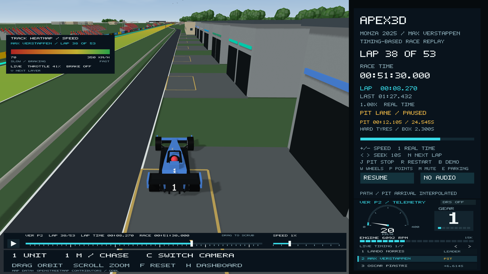

# Full 2025 Italian Grand Prix field

The replay now contains all 20 official entries and renders the 19 starters in
team colours. Use the arrows beneath the telemetry to browse seven pages of
three drivers, then click a row to focus that driver. Scrolling over the driver
list also changes pages. Selection preserves race time, playback speed, camera
mode and zoom. Only the selected active car has an overview pointer.

## Live timing tower

During the race the list is a **live timing tower**: the running order and each
car's gap to the leader at the current race time. The page holding the selected
driver opens first.

- **Order** comes from the recorded OpenF1 position feed, the same source as the
  live label (such as **LEC P3**), so the two always agree. Position numbers are
  the feed's own: for the first 16 seconds the feed still holds Hülkenberg's P12
  grid slot, so P12 is skipped until it drops him to the back.
- **Gaps** come from the recorded sector times, the way official timing measures
  them. Each car's gap is taken at the last timing line it crossed (the end of
  sector 1, 2 or 3) against the first car across that line on that lap, so gaps
  update three times a lap rather than continuously. A car the leader has already
  passed that line again before it arrives shows **+1 LAP**. The first sector-1
  crossing uses the derived first-lap sector described below.
- **PIT** (amber) shows between a car's pit entry and exit timing lines, which are
  estimates. Retired cars move to the bottom as **NC / OUT**, Hülkenberg stays at
  the bottom as **DNS**. Before the start the panel shows the grid.
- Order and gaps come from different recorded sources that update at different
  moments, so around pit stops a car can briefly show a smaller gap than the car
  listed ahead of it. Live timing towers show the same effect.

Once everyone has taken the flag, the gaps are the recorded finishing gaps (for
example Norris +19.207 s). From 1:15:00 race time, during the post-race scenes,
the list returns to the **final classification**. Result gaps there include
penalties; motion follows the on-track elapsed time. Antonelli's five seconds
and Bearman's ten seconds do not artificially slow their cars. Both retired/DNS
entries are labelled NC rather than assigned classified positions.



## Official entries and special cases

| Team | Drivers |
| --- | --- |
| Red Bull Racing | Max Verstappen, Yuki Tsunoda |
| McLaren | Lando Norris, Oscar Piastri |
| Ferrari | Charles Leclerc, Lewis Hamilton |
| Mercedes | George Russell, Kimi Antonelli |
| Williams | Alexander Albon, Carlos Sainz |
| Kick Sauber | Gabriel Bortoleto, Nico Hülkenberg |
| Racing Bulls | Isack Hadjar, Liam Lawson |
| Haas F1 Team | Oliver Bearman, Esteban Ocon |
| Alpine | Pierre Gasly, Franco Colapinto |
| Aston Martin | Fernando Alonso, Lance Stroll |

- Hülkenberg did not start. He remains selectable with DNS status, no circulating
  car, no recorded race telemetry and no race tyre set.
- Hadjar and Gasly start in the pit lane. Their release timing is estimated
  from their first recorded acceleration above 85 km/h near pit exit.
- Alonso completed 24 laps and retired during lap 25 with suspension failure.
  His return is reconstructed in the pit lane and his car is removed after the
  first persistent stationary, zero-engine sample at 34:52.493. This is an
  approximate withdrawal instant, not an official retirement timestamp.
- Ocon, Gasly, Colapinto and Stroll completed 52 laps. Their records are not
  padded with an invented 53rd lap.
- The race timer stops at Verstappen's 1:13:24.325 finish. A separate post-race
  clock lets the other finishers complete their recorded race laps before an
  illustrative in-lap and parking sequence. See [world details](monza-world-details.md).

## Data and reconstruction

`data/monza-2025-full-field.json` stores driver metadata, grid positions,
classification, on-track times, pit gates and estimated service positions.
Each driver has lap/sector and telemetry CSVs. DNS CSVs have headers only.
`monza-2025-tyre-stints.csv` contains all archived stints; the DNS pre-race
placeholder is excluded from the wheel inspector. Reused tyre ages are included.

FIA first-lap elapsed times replace approximate OpenF1 session-start durations.
First-sector durations on those laps are the elapsed time minus sectors two and
three. Missing sector one for Antonelli lap 12 and Stroll lap 43 is recovered
from the published lap duration minus the other sectors. All complete lap sums
match the on-track totals. Source URLs and response SHA-256 hashes are retained
in `data/monza-2025-full-field-provenance.json`.

Lap/sector gates anchor motion. Integrated recorded speed shapes the travel
between gates, normalized to this schematic circuit. Lateral lanes, passing
positions, garage dimensions and exact pit geometry are illustrative, not GPS
reconstruction or team-specific CAD models. Ten representative team garage
blocks replace the original two, positioned from estimated service distances.

Pit control entry/exit and stop durations come from OpenF1. Box-arrival time is
the midpoint between the last moving and first zero-speed sample. Box distance
is integrated speed after crossing the start/finish line. Telemetry retains the
existing UTC origin and approximately 0.19-second alignment uncertainty. Gauges
hold recorded samples for at most one second, then show gaps; DNS and retired
states show placeholders. The full telemetry table compiles once in a shared
static library to avoid reparsing it in every test and UI translation unit.

## Primary sources

- [Official starting grid](https://www.formula1.com/en/results/2025/races/1268/italy/starting-grid)
- [FIA race history chart](https://www.fia.com/sites/default/files/2025_16_ita_f1_r0_timing_racehistorychart_v01.pdf)
- [FIA final classification](https://www.fia.com/system/files/decision-document/2025_italian_grand_prix_-_final_race_classification.pdf)
- [OpenF1 API documentation](https://openf1.org/docs/), session 9912: drivers,
  laps, car_data, pit, stints and session_result.
- [Hülkenberg DNS report](https://www.formula1.com/en/latest/article/hulkenberg-dns-in-monza-was-massive-disappointment-as-bortoleto-hungry-for.34aG6r6981bDGaULehRuAY)
- [Alonso retirement](https://www.formula1.com/en/video/2025-italian-grand-prix-alonso-out-on-lap-25-after-suspension-failure.1842615987959149919)

## Local verification

```bash
python3 tools/generate_race_assets.py --check
cmake -S . -B build
cmake --build build --parallel
ctest --test-dir build --output-on-failure
checkpoint2/verify_all.sh
./build/Apex3D --driver hamilton --camera chase --wheels --screenshot-time 120 tmp/hamilton.ppm
```

The full-field test checks all lap crossings and on-track totals, monotonic
progress at half-second intervals, all scheduled stops and tyre changes,
retirement, DNS, pit starts, all selector pages and overlay bounds. Hidden native
OpenGL captures verify the starting pack, Hamilton's view, Alonso's retired
state and Hülkenberg's DNS state without interrupting an existing preview.
