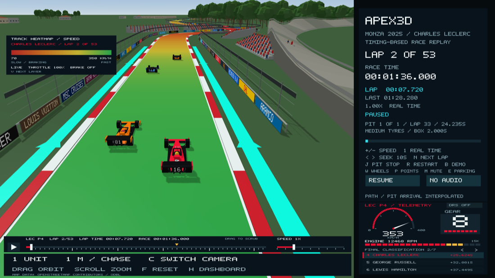
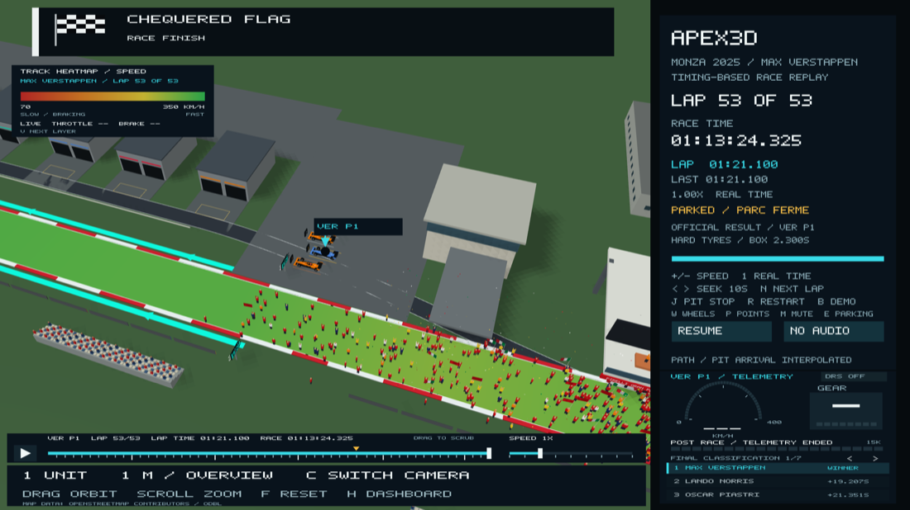
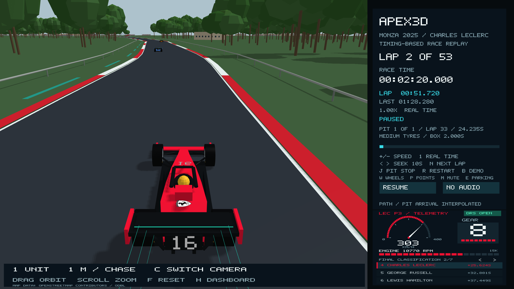
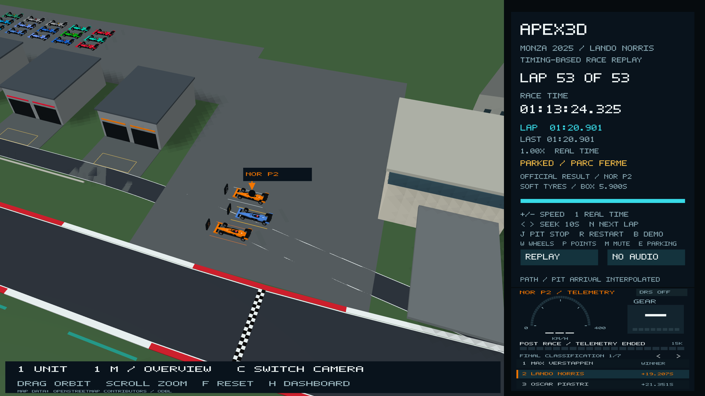

# Positions, team markings, Monza scenery and post-race return

The selected-driver label now reads, for example, `LEC P3`: the abbreviation and
current recorded race position. Permanent race numbers are printed on the nose
and rear of each car. All ten teams have their actual 2025 logo on both sidepods
and the engine cover, sampled from Formula 1's official 2025 image CDN assets.
These are team identifiers on a representative car, not an exact reproduction
of every team's Monza livery or proprietary bodywork.

Position changes come from OpenF1 session 9912, rather than an estimate from the
schematic car positions. The paged list continues to show final classification;
it is intentionally separate from the live label. DNS and retired drivers get
explicit DNS/DNF labels. The final parking labels use the official classification.

## DRS

The FIA's 2025 circuit map specifies activation 170 m after Turn 7 and 12 m after
the finish line. Both regions have a white activation line across the
track, tall DRS boards, bright cyan verge bands and chevrons every 40 m. On the
main straight they are on the grandstand side only, because the pit lane and
apron are on the other side. The bands are explanatory visual overlays, not a
claim that Monza's verges are painted cyan. The ends are schematic braking approaches before the
next corner; each driver's actual closing point comes from telemetry.

Recorded OpenF1 DRS codes 10, 12 and 14 drive the animation. Adjacent active
observations form intervals; gaps over one second are never joined. The rear
flap pivots from about 29 degrees (closed, high drag) to almost flat, opening a
slot above the main plane. Closed, it stays under the car's 1 m overall height.
Opening is eased over 0.2 s, with a glowing cyan flap edge and endplate markers
on every car, a dashboard DRS OPEN indicator and airflow lines on the selected car. Other cars also open their wings when their
own records say so. There is no invented acceleration multiplier. DRS is closed
in the pits, after the driver's race finish, and during the post-race animation.

## Trees and buildings

Monza's park authority describes broadleaf woodland with pedunculate oak,
hornbeam, ash, maple and other species. The conical evergreen models are replaced
by 3,274 irregularly distributed broadleaf trees, with varied heights, branching
trunks and overlapping rounded crowns. The woodland regions come from mapped
wood/forest polygons; individual tree positions and exact species assignments
are procedural. Crowns stay clear of the racing surface and spectator facilities.

`data/monza-scenery.json` contains 77 nearby building footprints and 19 woodland
areas extracted from OpenStreetMap on 9 November 2026, along with source
coordinates, landmark anchors and the source-response hash. This includes park
houses/cascine, service buildings, the medical centre, exhibition/hospitality
buildings and other nearby structures. Walls follow the mapped polygon; window
spacing, colours, missing heights and roof details are representative. Roofs
with simple pitched forms get a sloping cap. Footprints that conflict with the
simplified road are omitted. Existing grandstands and team garage representations
are retained rather than duplicated from OSM.

The Monza centreline is now measured from recorded car positions, and buildings,
woods and gravel are placed from their OSM coordinates with the same transform,
with no warping ([measured track geometry](real-track-geometry.md)). This is
still a source-backed reconstruction, not a survey or a complete 2025
photographic digital twin. OSM
is a current map, not a frozen map of race weekend. The derived map data carries
ODbL attribution in the application and its data licence file.

## The 1955 banking, trackside advertising and grandstands

- **Sopraelevata.** The high-speed ring's banked curves and its two bridges over
  the Grand Prix track come from OpenStreetMap ways (`data/monza-oval.json`),
  placed with the measured track's own transform. The banking is aged concrete
  with an old guardrail. Its outer edge rises with curvature (about 6 m on the
  ~320 m curves), and the approaches climb embankments to 6.5 m bridges.
  Centrelines are mapped; width, banking height and bridge height are
  representative, not surveyed. Trees are kept 11 m clear of it.
- **Advertising and catch fencing.** 1 m hoardings stand in front of the Armco,
  mostly within 260 m of a grandstand where spectators and cameras are, with
  fewer elsewhere. They carry the names of Formula 1's 2025–26 global partners
  (Pirelli, Aramco, DHL, Heineken 0.0, AWS, Lenovo, TAG Heuer, Louis Vuitton,
  MSC Cruises, Qatar Airways, Salesforce) in plain lettering on brand-like
  colours. A debris fence of posts, cables and a mesh band runs above the Armco.
  Board designs and positions are representative, not the race-day signage plan.
- **Grandstands.** An automated footprint check now compares every stand with its
  neighbours and the road. The two Prima Variante Esterna stands at Turn 1, at
  the end of the main-straight DRS zone, overlapped each other, and one was 10 m
  from the road where a straight stand met the chicane's kink. They now sit at
  895 m and 930 m: no overlaps, and every stand is at least 14 m from the road.





## After the finish

The official winner's race timer remains fixed at 1:13:24.325. A separate
post-race clock lets the remaining drivers complete their own recorded race
laps, followed by an illustrative in-lap (at least 180 seconds, staggered for safe arrivals) and a pit/apron parking
sequence. The top three park at boards 1, 2 and 3, with first place in the middle,
second on the far side and third nearest the pit wall. The remaining finishers
use the separate parking area. Alonso and Hülkenberg do not reappear.

This follows FIA document 31's procedure and relative layout around race
control, weighing, the podium and pit wall. Exact building dimensions, individual
post-race paths, parking coordinates and durations are reconstructed. No recorded
post-race speed, gear or RPM is invented; gauges show placeholders after each
driver's race telemetry ends.

Once the last car is parked, the **track invasion** begins: about 640 fans, mostly
in Ferrari red with some McLaren orange and a few tricolore flags, pour over from
the grandstand side and gather on the main straight beneath the podium. The
podium is cantilevered from the pit building out over the track, as it is at
Monza. After 20 s Verstappen, Norris and Piastri appear on the steps, then
confetti (from 30 s) and champagne (34–60 s). Playback stops 75 s after the
invasion starts. Monza's crowd really did invade the straight beneath the podium
in 2025. Every person, path and timing here is illustrative.

The traffic-spacing update reserves apron arrivals and fills bays in arrival order; see [race safety](race-safety-and-atmosphere.md).

`E` jumps to the moment the last car parks and plays the celebration. `R` restarts with the
lights. Space pauses/resumes the in-lap and parking sequence. Driver selection,
cameras, orbit, zoom and playback speed still work throughout.





## Sources and verification

- [Formula 1 partners](https://www.formula1.com/en/toolbar/partners.html); [2025 partner roster summary](https://rtrsports.com/en/blog/formula-1-sponsors-and-partners/)
- [2025 podium and track invasion beneath it](https://www.gbnews.com/sport/f1/lando-norris-booed-italian-grand-prix-max-verstappen); [record 2025 attendance](https://www.monzanet.it/en/?p=25427)

- [FIA circuit / DRS map, document 5](https://www.fia.com/system/files/decision-document/2025_italian_grand_prix_-_event_notes_-_circuit_map_pit_lane_emergency_exit_map_quarantine_zone_and_red_zones.pdf)
- [FIA post-race procedure and parking diagram, document 31](https://www.fia.com/system/files/decision-document/2025_italian_grand_prix_-_post-race_procedure.pdf)
- [Monza park flora](https://reggiadimonza.it/natura/)
- [Official circuit tour and site-map reference](https://www.monzanet.it/en/tour/)
- [OpenStreetMap contributors](https://www.openstreetmap.org/copyright)
- [OpenF1 documentation: position and car_data/DRS](https://openf1.org/docs/)
- All ten artwork URLs and hashes: `data/team-logo-pixels.json`.
- Additional source records: `data/monza-2025-world-provenance.json`.

The main asset consistency check verifies the event, scenery and logo headers
without requiring an image library. All six CTest suites cover recorded position
changes, DRS intervals, all team/logo assignments, car meshes, tree clearance,
parking separation/continuity, timer freeze and pause/restart behaviour. Native
OpenGL previews verify DRS, markings, woodland and the parked field.

```bash
python3 tools/generate_race_assets.py --check
cmake --build build --parallel
ctest --test-dir build --output-on-failure
./build/Apex3D --driver leclerc --camera chase --screenshot-time 140 tmp/drs.ppm
./build/Apex3D --driver norris --camera overview --zoom 0.025 --screenshot-post 360 tmp/parking.ppm
```
