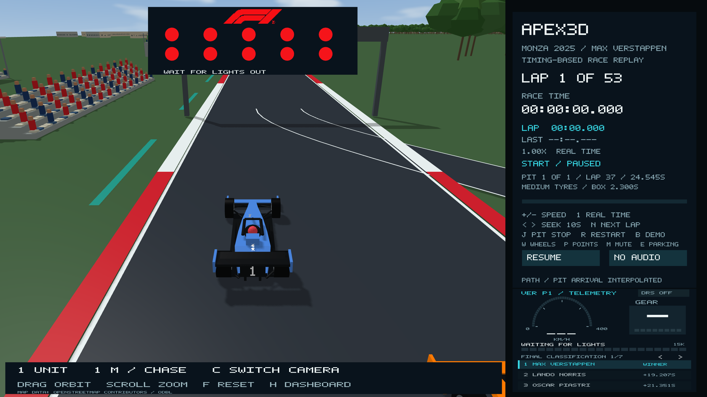
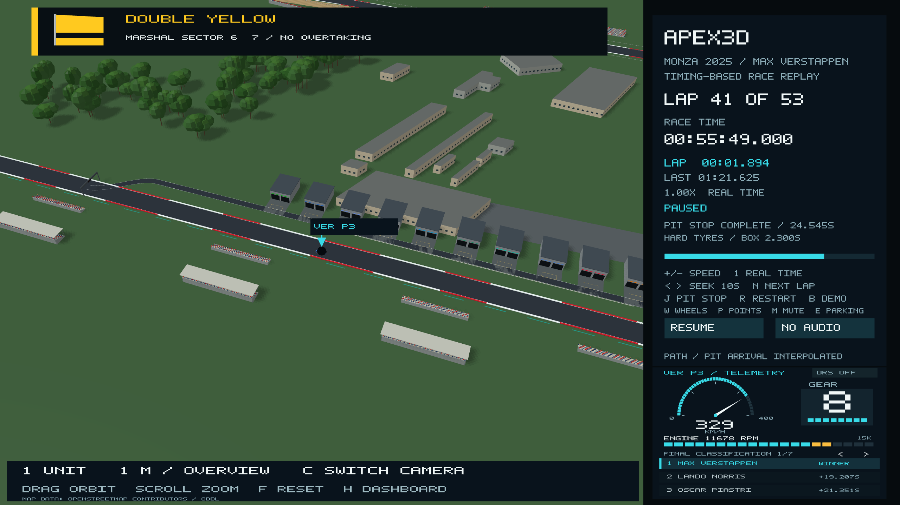

# Traffic spacing, start lights, race flags and atmosphere

Car motion was previously sampled independently, so two reconstructed cars could
occupy the same space. The scene now applies shared oriented body envelopes
covering the nose, wheels and wings. A look-ahead lane adjustment starts avoiding
predicted contacts; contact projection separates any remaining intersections.
The same constraint is applied after interpolation, so seeks and different
playback frame rates do not bypass it. This is a collision-free visual
reconstruction, not a simulation of the real drivers' steering or crash physics.
Recorded lap clocks, speed, gear, RPM and positions remain unchanged. Visual
positions may shift locally to keep the representative car bodies apart; crowded
cases can require longitudinal spacing and using the road margin.

The trajectory is generated lazily in 50 ms steps and cached in memory. Ordinary
playback builds only the next required steps. A first long seek needs to fill
that cache; subsequent seeks reuse it. Wheel rotation follows the corrected
travel distance. DNS and retired cars stay absent. Parking approaches split into
separate bays before reaching parked cars, with staggered in-laps and a reserved
apron arrival sequence. The remaining parking rows fill in arrival order so a
later car never needs to drive through an earlier parked car. The post-race
sequence remains illustrative; its race timer is still fixed at the official
winning time.

## Start signal

The official F1 logo is embedded above the five pairs of start lamps. Lamp
radii and row spacing now remain separate at narrow, standard and wide window
aspect ratios. The logo keeps its aspect ratio, and has its own vertical space.
It does not intersect the lamps. Lights remain separate circles and go out
together for the start. The logo source URL/hash is in `data/f1-logo-pixels.json`.

## Monza 2025 flags

`data/monza-2025-flags.json` retains the race-session flag events from OpenF1
session 9912, cross-checked against the FIA race-control report. Pre-race and
practice messages are excluded. Sector cautions remain active until their own
CLEAR event; the numbered track/marshal sectors are not the three lap-timing
sectors. A compact banner with a flag graphic appears over the scene:

| Race-clock time | Signal |
| --- | --- |
| 40:51.793 | Antonelli black-and-white warning, track limits |
| 48:48.793 | Gasly black-and-white warning, track limits |
| 54:18.793 | Colapinto blue flag |
| 55:42.793 | Double yellow, marshal sector 7 |
| 55:48.793 | Yellow, marshal sector 6 |
| 55:52.793 | Sector 7 clear; sector 6 remains yellow |
| 55:54.793 | Sector 6 clear |
| 1:09:10.793 | Colapinto blue flag |
| 1:12:13.793 | Ocon blue flag |
| 1:13:23.793 | Chequered flag message |

The local cautions correspond to the Sainz/Bearman Turn 5 incident. Blue flags
and black-and-white warnings are displayed as 12-second notifications; that is
a UI display duration, not an assertion about how long a marshal waved a flag.
The clear banner lasts six seconds. The archived message clock has second-level
precision and uses the existing replay-origin alignment; the official finish
clock remains 1:13:24.325. No safety-car, VSC or red-flag race interval is invented.

## Sky, ground and birds

A camera-oriented procedural sky replaces the flat background: blue zenith,
paler atmospheric horizon, sun glow and soft layered clouds. Lighting continues
to use the same sun direction. It is artistic scenery, not a reconstruction of
photographed clouds during the race.

The visible gravel/sand patches have been removed at the user's request. The
grass ground now extends across the visible world and continues analytically
to the horizon, with atmospheric haze hiding the far clipping boundary. The
existing camera zoom limits are unchanged. Archived gravel geometry remains
in the source data, but it is not added to the scene.

Exactly two birds follow distant flight paths at roughly 45–65 m altitude, with
small animated wings. There is no flock or random spawning. They pause with the
replay and are decorative, not a claim about wildlife recorded during the race.

## Sources

- [FIA Monza race-control report, 7 September 2025](https://www.fia.com/sites/default/files/2025_16_ita_f1_r0_timing_raceracecontrolmessages_v01.pdf)
- [OpenF1 race-control observations, session 9912](https://api.openf1.org/v1/race_control?session_key=9912)
- [FIA 2025 circuit and pit-lane maps](https://www.fia.com/system/files/decision-document/2025_italian_grand_prix_-_event_notes_-_circuit_map_pit_lane_emergency_exit_map_quarantine_zone_and_red_zones.pdf)
- [FIA 2025 race director's event notes](https://www.fia.com/system/files/decision-document/2025_italian_grand_prix_-_race_directors_event_notes_.pdf)
- [OpenStreetMap attribution](https://www.openstreetmap.org/copyright), footprint coordinates and extraction source in `data/monza-gravel.json`.
- [Official F1 logo asset](https://media.formula1.com/image/upload/f_png,w_400/v1677237319/etc/designs/fom-website/images/f1_logo.svg).

The new race-safety regression sweeps the race and parking sequence for body
intersections, checks arbitrary interpolation/seek times, bounds visual spacing
adjustments, and checks final parking, flags, intro bounds and birds.
Native OpenGL captures verify the sky shader, lamp separation and flag banner.

