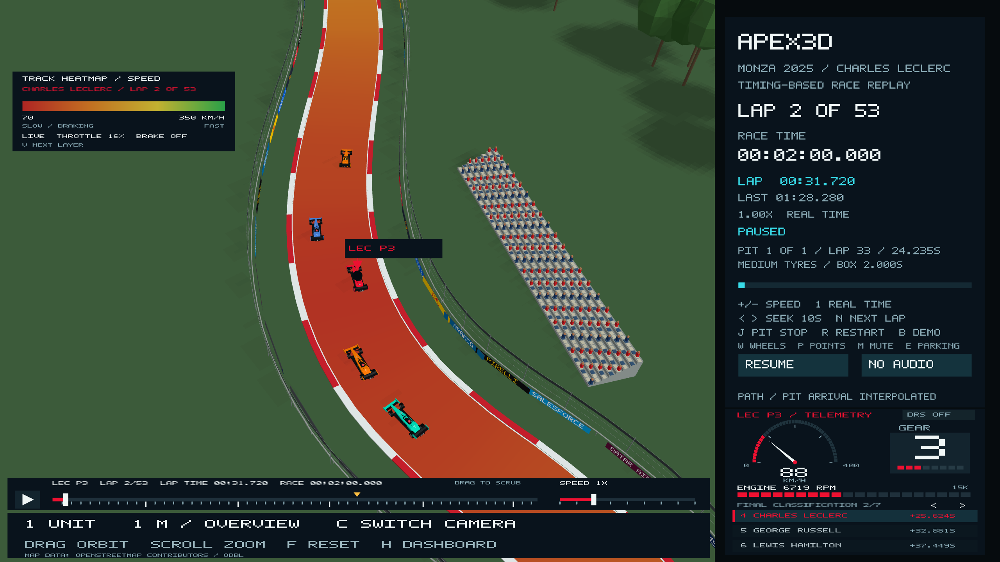
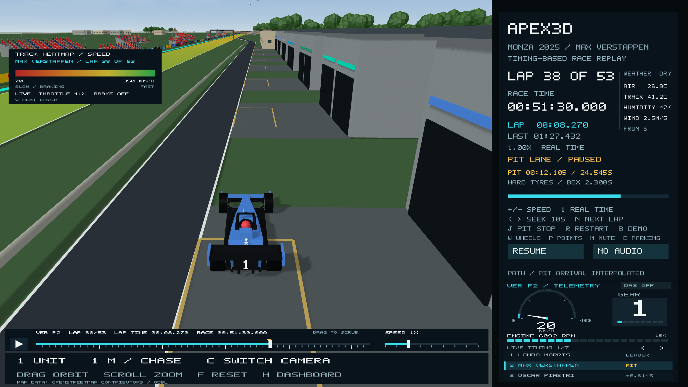
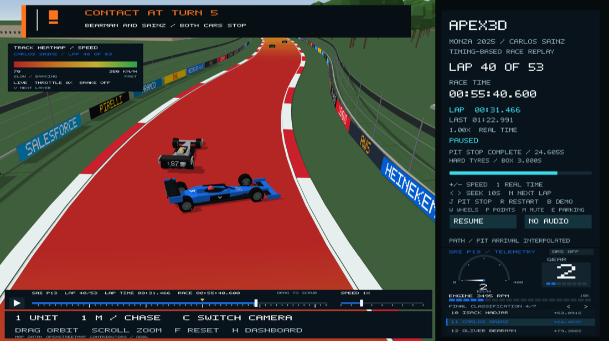

# Traffic spacing, start lights, race flags and atmosphere

Car motion was previously sampled independently, so two reconstructed cars could
occupy the same space. The scene now applies shared oriented body envelopes
covering the nose, wheels and wings. A look-ahead lane adjustment starts avoiding
predicted contacts; contact projection separates any remaining intersections.
The same constraint is applied after interpolation, so seeks and different
playback frame rates do not bypass it. This is a collision-free visual
reconstruction, not a simulation of the real drivers' steering or crash physics.
Recorded lap clocks, speed, gear, RPM and positions remain unchanged. Visual
positions may shift locally to keep the representative car bodies apart; crowded
cases can require longitudinal spacing and using the road margin.

The trajectory is generated lazily in 50 ms steps and cached in memory. Ordinary
playback builds only the next required steps. A first long seek needs to fill
that cache; subsequent seeks reuse it. Wheel rotation follows the corrected
travel distance. DNS and retired cars stay absent. Parking approaches split into
separate bays before reaching parked cars, with staggered in-laps and a reserved
apron arrival sequence. The remaining parking rows fill in arrival order so a
later car never needs to drive through an earlier parked car. The post-race
sequence remains illustrative; its race timer is still fixed at the official
winning time.

## Start signal

The official F1 logo is embedded above the five pairs of start lamps. Lamp
radii and row spacing now remain separate at narrow, standard and wide window
aspect ratios. The logo keeps its aspect ratio, and has its own vertical space.
It does not intersect the lamps. Lights remain separate circles and go out
together for the start. The logo source URL/hash is in `data/f1-logo-pixels.json`.

## Monza 2025 flags

`data/monza-2025-flags.json` retains the race-session flag events from OpenF1
session 9912, cross-checked against the FIA race-control report. Pre-race and
practice messages are excluded. Sector cautions remain active until their own
CLEAR event; the numbered track/marshal sectors are not the three lap-timing
sectors. A compact banner with a flag graphic appears over the scene:

| Race-clock time | Signal |
| --- | --- |
| 40:51.793 | Antonelli black-and-white warning, track limits |
| 48:48.793 | Gasly black-and-white warning, track limits |
| 54:18.793 | Colapinto blue flag |
| 55:42.793 | Double yellow, marshal sector 7 |
| 55:48.793 | Yellow, marshal sector 6 |
| 55:52.793 | Sector 7 clear; sector 6 remains yellow |
| 55:54.793 | Sector 6 clear |
| 1:09:10.793 | Colapinto blue flag |
| 1:12:13.793 | Ocon blue flag |
| 1:13:23.793 | Chequered flag message |

The local cautions correspond to the Sainz/Bearman Turn 5 incident. Blue flags
and black-and-white warnings are displayed as 12-second notifications; that is
a UI display duration, not an assertion about how long a marshal waved a flag.
The clear banner lasts six seconds. The archived message clock has second-level
precision and uses the existing replay-origin alignment; the official finish
clock remains 1:13:24.325. No safety-car, VSC or red-flag race interval is invented.

## Sky, ground and birds

A camera-oriented procedural sky replaces the flat background: blue zenith,
paler atmospheric horizon, sun glow and soft layered clouds. The clouds are
artistic scenery, not a reconstruction of photographed clouds during the race.

### The real sun

The sun is where it really was. `sun_position.hpp` uses NOAA's general
solar-position equations with the finish line's coordinates and the recorded
race-clock origin, 13:03:35 UTC on 7 September 2025 (OpenF1 session 9912), plus
race time. At the start the sun is 44.4 degrees high in the south-west (azimuth
217 degrees). By the chequered flag it has sunk to about 35 degrees at azimuth
238 degrees, so shadows lengthen and swing east during the race and the
post-race scenes. Lighting, shadows, the sky glow and the far ground all use it.
True north comes from the measured track's map transform. A hand calculation
checks the result: declination 5.85 degrees (from the 22 September equinox) and
spherical trigonometry give 44.45 / 217.1 degrees at the start. Refraction
(about one arcminute) is ignored.

Direct sunlight also warms slightly as the sun sinks. Its light crosses more air:
the air mass goes from 1.43 at the start to 1.75 at the flag (Kasten–Young
formula). Rayleigh scattering removes blue faster than red (clear-sky optical
depths 0.044, 0.097 and 0.22 at 680, 550 and 450 nm). `sunlightTint` scales the
sun's diffuse light, highlights and glow by that change, normalised to the race
start. By the flag direct light is about 1% less red, 3% less green and 7% less
blue. Ambient sky light, aerosols and clouds are not modelled.

The visible gravel/sand patches have been removed at the user's request. The
grass ground now extends across the visible world and continues analytically
to the horizon, with atmospheric haze hiding the far clipping boundary. The
existing camera zoom limits are unchanged. Archived gravel geometry remains
in the source data, but it is not added to the scene.

Four small flocks of four birds (16 in total, crow/pigeon size with about a 1 m
wingspan) circle at 16–27 m over the main straight, the Curva Grande, Ascari and
the Parabolica. Each bird trails its neighbour slightly and flaps on its own
phase. The earlier two birds at 45–65 m were too small and high to notice. There
is no random spawning. Birds pause with the replay and are decorative, not a
claim about wildlife recorded during the race.

## Race weather

The side panel shows the recorded trackside weather in a column right of the
clocks: air and track temperature, humidity, and wind speed with the compass
direction it blows from. The data is OpenF1's weather feed for session 9912
(`data/monza-2025-weather.json`, with the response's SHA-256), 144 readings about
a minute apart from an hour before the start until after the post-race scenes.
The panel shows the latest reading at or before the race time, not an
interpolation, so every number on screen was recorded.

| During the race | Range |
| --- | --- |
| Air | 26.6–27.4 °C |
| Track | 40.3–44.7 °C |
| Humidity | 40–44 % |
| Wind | 0.6–4.0 m/s, mostly from the south and south-west |
| Rain | none |

Open-Meteo's historical archive for the same point (a reanalysis averaged over a
grid cell several kilometres across) agrees: dry, light south-westerly wind, and
25.2–25.4 °C between 13:00 and 14:00 UTC. The trackside sensor reads about two
degrees warmer, as expected beside a sunlit circuit. The wind is light air to a
gentle breeze, so nothing in the scene is animated by it.

## The Bearman/Sainz collision (lap 41)

There were no race-ending crashes in the 2025 Italian Grand Prix: no safety car,
VSC or red flag. Alonso retired with suspension failure and Hülkenberg did not
start (both already shown). The race's one collision was on the leader's lap
41, at Turn 5 (Variante della Roggia). Bearman hit Sainz, both cars stopped,
and the stewards gave Bearman a 10-second penalty for causing a collision.

| Race clock | What the replay shows | Source |
| --- | --- | --- |
| 55:39.9 | "Contact at Turn 5" banner; Sainz's car spins | Speed telemetry: Sainz 85 → 23 km/h within 0.6 s, 0 km/h at 55:44.3; Bearman stationary 55:41.5–55:43.6 |
| 55:42.8–55:54.8 | Double yellow / yellow (unchanged) | Race control |
| 56:57.8 | "Incident noted" | Race control |
| 58:13.8 | "Under investigation" | Race control |
| 1:03:36.8 | "10 second penalty, car 87" | Race control |

The data is in `data/monza-2025-incidents.json`; its race-control download has
the same SHA-256 as the flags file. **The spin is illustrative.** OpenF1 positions
are snapped to the track line, so a car's heading and sideways path are not
recorded. Only the time, place and speeds are factual. Safety flags take
priority over incident banners when both apply.

## Sources

- [FIA Monza race-control report, 7 September 2025](https://www.fia.com/sites/default/files/2025_16_ita_f1_r0_timing_raceracecontrolmessages_v01.pdf)
- [OpenF1 race-control observations, session 9912](https://api.openf1.org/v1/race_control?session_key=9912)
- [OpenF1 weather, session 9912](https://api.openf1.org/v1/weather?session_key=9912)
- [Open-Meteo historical weather archive](https://open-meteo.com/en/docs/historical-weather-api) (cross-check only)
- [FIA 2025 circuit and pit-lane maps](https://www.fia.com/system/files/decision-document/2025_italian_grand_prix_-_event_notes_-_circuit_map_pit_lane_emergency_exit_map_quarantine_zone_and_red_zones.pdf)
- [FIA 2025 race director's event notes](https://www.fia.com/system/files/decision-document/2025_italian_grand_prix_-_race_directors_event_notes_.pdf)
- [OpenStreetMap attribution](https://www.openstreetmap.org/copyright), footprint coordinates and extraction source in `data/monza-gravel.json`.
- [Official F1 logo asset](https://media.formula1.com/image/upload/f_png,w_400/v1677237319/etc/designs/fom-website/images/f1_logo.svg).

The new race-safety regression sweeps the race and parking sequence for body
intersections, checks arbitrary interpolation/seek times, bounds visual spacing
adjustments, and checks final parking, flags, intro bounds and birds.
Native OpenGL captures verify the sky shader, lamp separation and flag banner.

