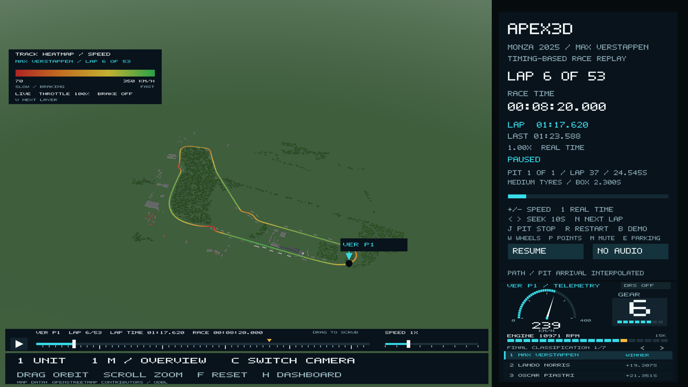
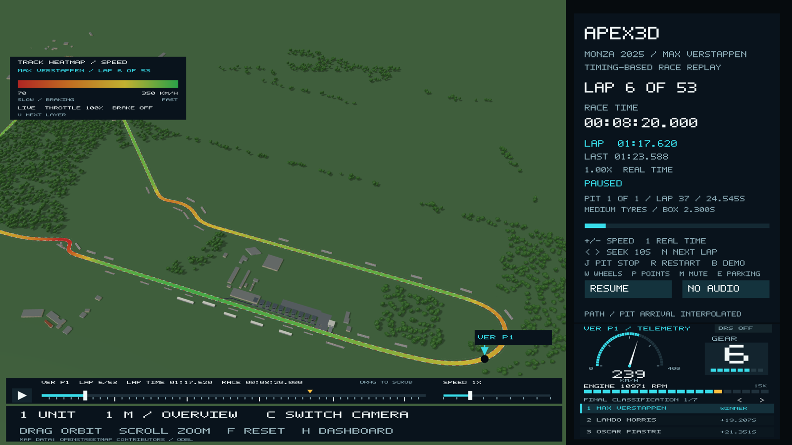
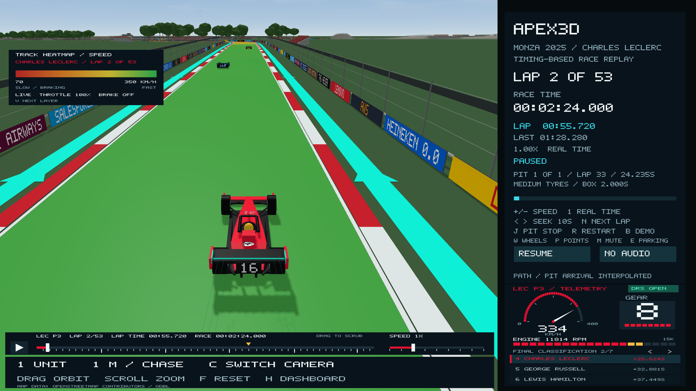
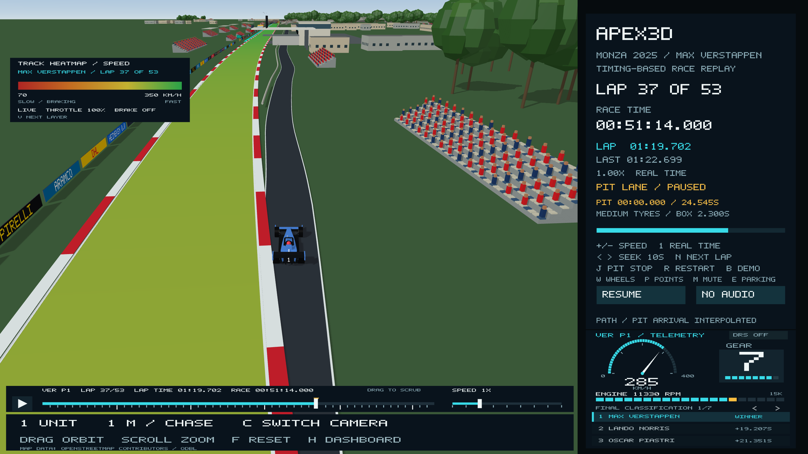
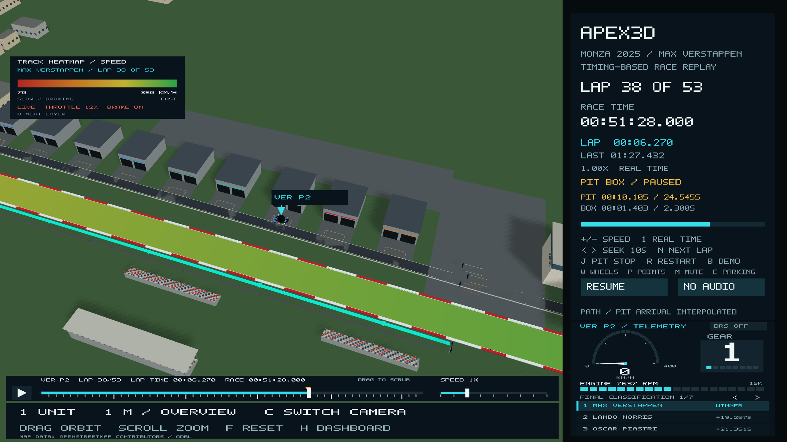
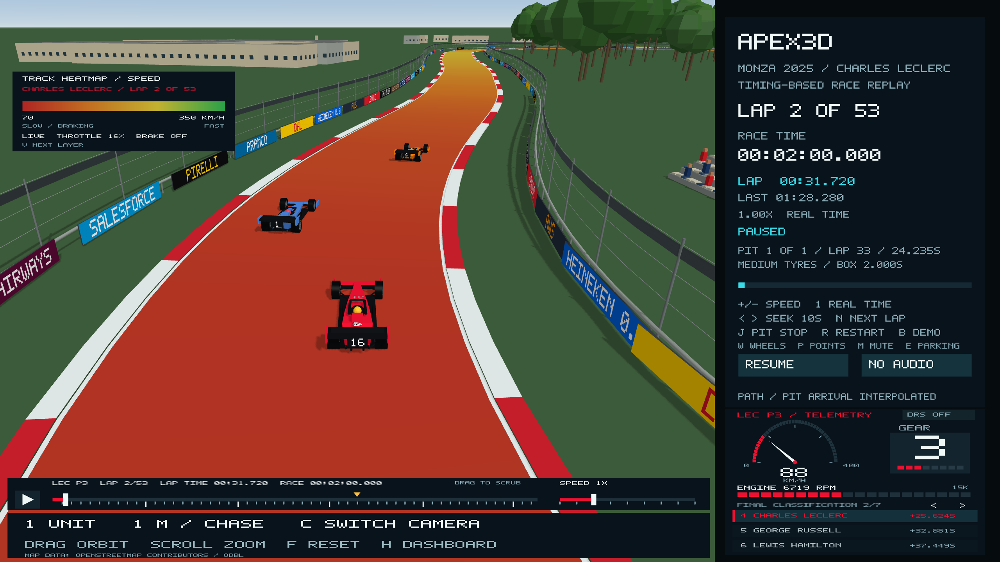

# Measured Monza track geometry

The track used to be 62 points drawn by hand from the Formula 1 circuit map. It
had the right corners in the right order, but the shape was distorted. Even the
best rotate-and-scale fit left its corners about 130 m from the real ones on
average, and up to 270 m. The track is now measured from where the cars actually
drove during the 2025 race.





## Where the shape comes from

OpenF1's `/v1/location` endpoint records each car's x, y and z position
about 3.7 times a second, in decimetres, for the same race (session 9912) the
timing and telemetry already come from. `tools/build_track_centreline.py`:

1. Loads positions and lap start times for five cars that ran the whole race
   without incident: Verstappen, Norris, Piastri, Leclerc and Russell.
2. Keeps only clean racing laps: not lap 1 (standing start), no pit-in or
   pit-out laps, and only laps within 3% of that driver's median. That leaves
   **249 laps** and about 75,000 position samples.
3. Takes one clean Verstappen lap (lap 10) as a first guess.
4. **Iterative averaging.** Each sample is projected onto the current guess.
   That gives its distance along the lap and how far it sits to the left or
   right. Offsets are averaged in 5 m bins and smoothed with a Gaussian. The
   guess is moved sideways by that average and resampled every 5 m. Four passes
   settle the line.
5. **Finish line.** Distance 0 is the average place cars were when OpenF1 says
   a new lap started (1,000+ crossings).
6. **Sector lines.** The same trick at "lap start + sector 1 time" and "lap
   start + sector 1 + 2 times" gives the real sector boundaries: **1,894.5 m**
   and **3,704.0 m** along the lap (median of 255 laps). They replace the old
   positions, which were estimated by eye from the FIA map.
7. **Georeferencing.** The line is fitted to OpenStreetMap's mapped Grand Prix
   raceway (the same OSM download the scenery uses), allowing only rotation,
   one uniform scale and a shift. Iterative closest point finds the best fit.

Output: `data/monza-2025-centreline.csv` (distance, OpenF1 x/y, elevation,
longitude, latitude every 5 m) and `data/monza-2025-centreline-provenance.json`
(method, laps used, every download URL and SHA-256 hash, fit quality).
Each laps download is byte-identical to the one already recorded in
`data/monza-2025-full-field-provenance.json`.

## How well it matches

| Check | Result |
| --- | --- |
| Fit scale to OSM (1.0 = same size) | 0.9992 |
| Distance from the OSM-mapped centreline | mean 2.2 m, 95% within 4.4 m, max 8.4 m |
| Measured lap length | 5,758.4 m (official centreline length 5,793 m) |
| Elevation range in the data | 12.4 m |

Two independent sources agreeing within a few metres on a 12 m wide road is
strong evidence that the shape is right.

**Driven line vs painted centreline.** The cars' line is 35 m (0.6%) shorter
than the official length because it cuts each chicane. The scene keeps the
official 5,793 m so existing lap distances, pit timing and wheel rotation are
unchanged. The renderer therefore stretches the measured shape, and everything
placed with it, uniformly by 0.6%. That is about 7 m across the 1.2 km width
of the circuit.

**OpenF1 positions are already smoothed.** Individual samples sit within
0.04 m (median) of the averaged line, which is far tighter than raw GPS. The
timing feed appears to snap cars onto one reference line. So this is the
timing system's track line, not each driver's own racing line.

## How it gets into the scene

`tools/generate_track_assets.py` (run by `tools/generate_race_assets.py`, and
checked in CI) turns the CSV into `include/apex3d/generated/monza_track_2025.hpp`:

- **576 control points, one every 10 m**, replace the 62 hand-drawn anchors.
  The CP2 Catmull-Rom spline and the CP3 Bézier chain both use them, so those
  teaching algorithms are unchanged. Only their input is now measured.
- The scene keeps its 2D scene units. The finish line stays at (1.16, -0.87)
  and the main straight still runs along -x, so cameras, the HUD map and the
  pit lane code work as before. One scene unit is 675 m of ground before the
  0.6% stretch.
- **Buildings, woods and gravel** now use the same `to_scene` transform from
  their original OSM longitude/latitude. Before, a thin-plate spline bent them
  to fit the distorted drawing. They now sit exactly where the map puts them
  relative to the road.
- **Grandstands and turn markers** (DRS boards at Turns 1, 7 and 8) were
  estimated against the old drawing. They were carried to the same place on
  the measured track using the 14 recorded corner landmarks as a
  distance-along-the-lap mapping (`legacy_to_fraction`). The grandstand CSV
  was migrated once with `python3 tools/generate_track_assets.py --migrate-stands`.
- **Elevation** is now drawn; see the next section.

## Elevation

The recorded OpenF1 `z` values give the lap's height profile: about 12 m of
relief. From the finish line the road climbs about 10 m to its high point
approaching the Lesmos, dips through Ascari, and reaches its lowest point at
Parabolica, 2.9 m below the line.

`include/apex3d/terrain.hpp` turns the 576 control-point heights into a 16 m
height map covering the circuit plus 900 m around it:

- On the track the height is the measured elevation. The test checks every
  control point is within 0.25 m. Across the 12 m road it varies by under
  0.1 m, so no banking is invented.
- Off the track there is no survey. The height comes from nearby track heights
  (a Gaussian average whose width grows with distance) and fades to the lap's
  mean height between 80 m and 450 m from the road. Slopes stay below 6%.
  This is a smooth fill, not the park's real terrain.

The scene is still built flat. The renderer's vertex shaders lift every vertex
by the height under it, using the same bilinear lookup as the CPU copy. That
covers the road, ground, cars, buildings, birds and the shadow pass, so
everything follows one surface and cars pitch with the slope. The ground is one
quad per height texel so it matches the map exactly. Cameras and the overview
marker use the CPU copy, so the camera rides over crests and the cockpit view
pitches with the road. Heights are real, not exaggerated, so at 12 m over
5.8 km the effect is subtle, as it is at Monza.



## What is still estimated

- Terrain away from the road (see Elevation above) is a smooth fill from the
  track heights, not a survey.

- Track width is still a uniform 12 m. Armco follows the line at a fixed
  offset. Kerb positions come from curvature (below); their lengths are
  representative.
- The pit timing lines that the recorded pit durations span (86 m before the
  finish line and 332 m after it) are estimates; the lane itself is measured
  (see below). Lane width (4 m) and garage positions are representative.
- Between timing gates, cars are still placed by recorded speed rather than by
  their own recorded positions.
- Grandstand positions are carried estimates, not surveyed.

## Pit lane

The pit lane is now the mapped one: OpenStreetMap way 38168747 ("Pit Lane"),
copied into `data/monza-pit-lane.json` with the same source hash as the rest of
the scenery (`python3 tools/generate_track_assets.py --extract-pit-lane`). The
generator projects each of its 22 nodes onto the measured track line. That
gives a distance along the lap and a sideways offset for each node. It adds a
25 m run-in and run-out from the track centreline, interpolates smoothly
(monotone cubic, no overshoot) and writes the offset every 5 m
(`pitLaneLateral`).

- The lane leaves the track 318 m before the finish line, just after
  Parabolica, and rejoins it 482 m after the line, before the first chicane.
  It replaced a guessed 18 m offset that ran from 86 m before the line to
  332 m after it.
- It sits 15-19.4 m right of the track centreline along the garages, angling
  slightly away from the track, as mapped.
- `RaceMotion::pitPose` offsets cars along the track normal by this profile.
  Every car (Verstappen, the podium pair, the full field, pit-lane starts,
  retirements and post-race in-laps) is in the lane from where it leaves the
  track to where it rejoins. The recorded pit durations still run between the
  estimated timing lines inside it.
- The pit wall follows the lane 3 m in from its centre, wherever the lane is
  fully separated from the track. Garages sit beside their teams' estimated
  boxes on the lane.
- Tests check the lane's ends and offsets, that no mapped building is within
  3 m of its centreline, and that cars move without jumps into, through and
  out of it.





## Kerbs

Kerbs used to run along both edges of the whole lap. Real kerbs sit at corners,
and OpenStreetMap doesn't map circuit kerbs, so `kerbLayout` in `scene3d.hpp`
places them from the measured line's curvature (smoothed over ±25 m):

- An inside kerb through every corner tighter than a 400 m radius, from 10 m
  before to 10 m after.
- An outside kerb from mid-corner to 25 m past the exit, for corners tighter
  than 150 m.
- No kerb on the pit side where the pit lane leaves or rejoins the track.

That finds exactly Monza's 11 turns: the Rettifilo (T1–2, both sides), Curva
Grande (T3), the Roggia (T4–5, both sides), Lesmo 1 and 2 (T6–7), the Ascari
chicane (T8–10, both sides) and Parabolica (T11). The straights keep only their
white edge lines. A test checks there are no kerbs on the straights, an inside
kerb at each turn, and that less than 40% of the lap is kerbed.



## Rebuild and verify

```bash
python3 tools/build_track_centreline.py            # downloads missing OpenF1 files into tmp/openf1/
python3 tools/build_track_centreline.py --offline  # cached files only
python3 tools/generate_race_assets.py              # regenerate headers
python3 tools/generate_race_assets.py --check
ctest --test-dir build --output-on-failure
./build/Apex3D --camera overview --zoom 1.6 --screenshot-time 500 whole.ppm
```

The OSM georeference needs the scenery download in `tmp/monza-world/` (its hash
must match `data/monza-scenery.json`). Generating headers needs only the
checked-in CSV and JSON files.

## Sources

- [OpenF1 API: location, laps](https://openf1.org/docs/) (unofficial, non-commercial use)
- [OpenStreetMap contributors](https://www.openstreetmap.org/copyright), ODbL 1.0
- [Autodromo Nazionale Monza: circuit length](https://www.monzanet.it/en/circuit/)
