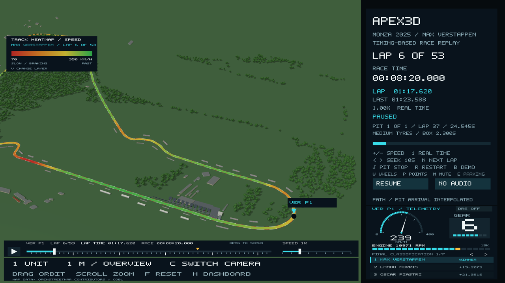
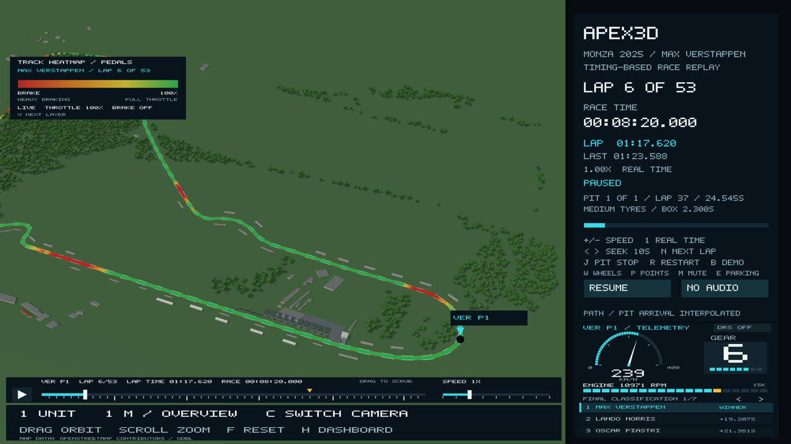

# Track heatmap and timeline

This delivers three promises from the original proposal: **colouring the track
surface with telemetry**, **switching between telemetry layers**, and **scrubbing
through the replay with a timeline**. The legend also shows the live **throttle %**
the proposal listed.





## What you see

- The 12 m road is painted by the selected driver's recorded telemetry on the lap
  they are currently driving. **V** cycles through the layers:

  | Layer | Red end | Green end |
  | --- | --- | --- |
  | **Speed** | 70 km/h (slow / braking) | 350 km/h (fast) |
  | **Throttle** | 0% (lifting / coasting) | 100% (full throttle) |
  | **Brake** | brake on | brake off |
  | **Pedals** | braking | full throttle (coasting shows amber) |
  | **Off** | no colour | |

  **Pedals** is the proposal's own example: "green for throttle, red for braking".
- The key in the top-left corner shows the scale, the driver and lap, and a **live**
  line with the selected driver's throttle % and brake state at this moment. The scales
  are fixed, so laps and drivers can be compared by colour alone.
- The track repaints when you select another driver, start a new lap or change layer.
- The bar under the scene has a **play/pause button**, the **lap time**, a **race
  timeline** and a **speed slider**. Drag the timeline to scrub through the race.
  Small ticks mark each of the selected driver's laps (taller every 10 laps) and an
  amber triangle marks their pit stop. The speed slider has nine notches, doubling
  each time from 0.25x to 64x (the same range as `+`/`-`).

## How it works (graphics pipeline)

Code: `include/apex3d/telemetry_heatmap.hpp`, `include/apex3d/replay_controls.hpp`.

1. **Choose the data.** Take the driver's recorded telemetry samples that fall
   inside one lap's official timing window. Lap 1 starts at lights-out.
2. **Place each sample on the track.** For each sample time, ask the replay's
   `FieldMotion` where the driver was along the centreline. This is the same
   timing-gate reconstruction that moves the car. Samples taken in the pit lane are
   skipped because the pit lane is a different road.
3. **Fill the gaps.** Samples are about 20 m apart at racing speed. Every centreline
   point between two samples gets a value by **linear interpolation along the track
   distance**, wrapping across the start/finish line.
4. **Map values to colours.** The value becomes a 0–1 fraction of the layer's
   scale (70–350 km/h for speed, 0–100% for the pedal layers; brake is reversed so
   "on" is red). A **piecewise-linear colour ramp** with four stops (red → amber → yellow →
   green) turns that fraction into RGB. A quarter of the asphalt colour is mixed back in
   so the surface still reads as tarmac.
5. **Build the mesh.** One thin strip per centreline segment sits 5 mm above the
   asphalt. Each end of the strip gets **its own vertex colour**, and OpenGL
   interpolates colour across each triangle (Gouraud-style). That gives smooth
   gradients instead of blocks. The legend bar is drawn the same way.
6. **Draw it.** The overlay uses the normal lit shader, so sun shading and car shadows
   fall on it. A small **polygon offset** pulls it towards the camera so the asphalt
   underneath never shows through (no z-fighting). It is rebuilt only when the
   driver, lap or layer changes, not every frame.

The timeline maps race time linearly onto the bar. Clicking or dragging converts the
mouse position back to a race time and seeks there. Drawing and click detection use
the same layout function, so the clickable area matches what is drawn.

**Smooth scrubbing.** The replay caches car spacing in 50 ms steps, and filling that
cache far ahead can take a few seconds. The app now fills it a little each frame in
the background. The lighter part of the timeline shows how much is ready. Jumps inside
it are instant, and the results are identical because frames are computed in the same
order as a normal seek.

**No flicker when zoomed out.** The chase camera's near plane used to be fixed at
5 cm while drawing out to 15 km, which left too little depth precision far down
the road to separate the strip from the asphalt 5 mm below it. They swapped places
from frame to frame. The near plane now scales with camera distance (2% of it in
chase view, as the overview already did) and the polygon offset is stronger.

## Accuracy limits

- Speed, throttle and brake values are the **archived OpenF1 car-data readings**, not
  estimates.
- **OpenF1 brake is on/off** (0 or 100), not brake pressure. The brake layer shows
  where the brake was on, so it cannot show "heavy" versus "light" braking. Where
  colours blend between samples, the edges of a braking zone fade over a few metres.
- OpenF1 occasionally reports **104** in throttle and/or brake on normal full-throttle
  samples (52 of 305,348 rows across the field). That is a source glitch code.
  It is kept unchanged in the CSV files for traceability and skipped by the pedal layers
  and the live readout.
- **Where** each reading lands on the track follows the replay reconstruction: lap and
  sector crossings are exact, and positions between them are shaped by recorded speed,
  not GPS. So a red patch is at the right corner, but its exact start metre is
  approximate.
- Between samples the colour is interpolated, so very short braking spikes can be
  smoothed.
- Lap 1 includes the standing start, so the grid area shows red.
- Hülkenberg (DNS) has no recorded lap, so his heatmap is empty.

## Where the throttle and brake data came from

The telemetry CSVs now have two extra columns: `throttle_pct` and `brake`.
`tools/add_car_controls.py` added them from the same OpenF1 `car_data` responses
(session 9912) that the original speed/gear/RPM columns came from:

- Each driver's response was downloaded again. Its **SHA-256 matched the hash already
  recorded** in `data/monza-2025-full-field-provenance.json`, so it is byte-for-byte the
  same source.
- For every existing row, race time, speed, gear and RPM were checked to be
  **identical** to the raw sample before throttle and brake were added. No existing
  value changed, so earlier timing, alignment and tests are unaffected.
- Hülkenberg's file stays header-only (he did not start).

`python3 tools/add_car_controls.py --check` re-verifies the columns offline. The raw
downloads are cached in the ignored `tmp/openf1/` folder.

## Verify

```bash
ctest --test-dir build -R heatmap --output-on-failure
./build/Apex3D --camera overview --zoom 0.6 --screenshot-time 500 heatmap.ppm
./build/Apex3D --heatmap pedals --camera overview --zoom 0.6 --screenshot-time 500 pedals.ppm
./build/Apex3D --heatmap off --screenshot-time 500 no_heatmap.ppm
python3 tools/add_car_controls.py --check
```
