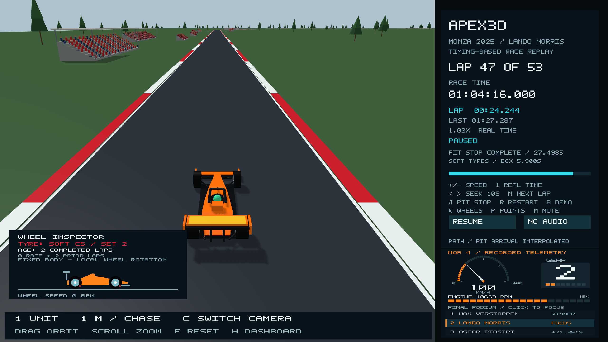

# Tyre compound and laps on the current set

Press `W` to show the wheel inspector for the selected podium driver. It now
shows the tyre compound, set number, total completed laps on that set, and the
split between this race and prior use. These are **tyre-set ages**, not the age
of the metal wheel/rim and not an estimated percentage of remaining grip.

The archived [OpenF1 stint records for Monza session 9912](https://api.openf1.org/v1/stints?session_key=9912)
show:

| Driver | First set | Second set | Previous use of second set |
| --- | --- | --- | --- |
| Verstappen | Medium, laps 1–37 | Hard, laps 38–53 | 0 laps |
| Norris | Medium, laps 1–46 | Soft, laps 47–53 | 2 laps |
| Piastri | Medium, laps 1–45 | Soft, laps 46–53 | 3 laps |

The event's dry compound codes are C3/Hard, C4/Medium and C5/Soft. See the
[FIA/Pirelli 2025 event preview](https://www.fia.com/system/files/decision-document/2025_italian_grand_prix_-_event_notes_-_pirelli_preview.pdf).
The label and tyre-sidewall marker use white, yellow and red respectively.
The McLarens' post-stop compound is soft; it must not be inferred from
Verstappen's medium-to-hard strategy.

`data/monza-2025-tyre-stints.csv` preserves the six source stints, including
`tyre_age_at_start`. The generated C++ table is verified by the existing
asset generator. The raw response hash and endpoint are in the provenance JSON.

Ages count **completed laps**, so a new set shows zero during its out lap and
increments at the next timing-line crossing. A reused set starts with its
recorded prior age: Norris's softs show `2 COMPLETED LAPS / 0 RACE + 2 PRIOR`
immediately after fitting. The display switches at modeled service completion,
not merely when the lap counter advances, because the timing line is inside
this pit visit. During service it says `TYRE CHANGE IN PROGRESS` and retains
the outgoing set until that transition. Pit service alignment remains approximate
as documented in the telemetry research.

At each driver's own 53-lap finish the modeled set ages are 16 laps for
Verstappen's hards, 9 for Norris's softs and 11 for Piastri's softs. The replay
ends at Verstappen's finish; the other two displays reflect their actual
progress at that earlier instant. Seeking, replaying and selecting another
driver recompute the set and age directly.

Tests cover new and used sets, before/after fitting, the first completed out lap,
final ages, and rewind/reset. Native OpenGL captures check both new hard and
used soft readouts and panel placement.
